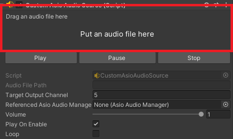

## AsioAudioSource

The AsioAudioSource component is designed to manage audio playback using the NAudio library in conjunction with an ASIO driver. It provides functionality for loading, configuring, and controlling audio files, while integrating with an [AsioAudioManager](/Documentation~/Audio%20Components/AsioAudioManager.md) for playback coordination.

### Typical Workflow and Features

1. Audio File Setup: When the component is enabled, the audio file is opened, mixed down to mono, and resampled on the fly to the [AsioAudioManager](/Documentation~/Audio%20Components/AsioAudioManager.md)'s `TargetSampleRate`. Files can have any sample rate and bit depth: nothing is converted or written to disk. The file's own format is shown in the read-only properties (`SampleRate`, `Channels`, `BitsPerSample`...).
2. Playback:
    - The Play, Pause, Stop, Restart and Seek methods control playback instantly, without interrupting the other sources. Play, Pause and Stop fade in or out over 5 ms to avoid clicks.
    - `Volume` (applied smoothly), `Loop` (seamless) and `TargetOutputChannel` can be changed while playing, from code or from the Inspector.
    - `CurrentTimestamp` follows the position actually played by the ASIO driver. When a non-looping file reaches its end, the source stops and `OnStop` is triggered.
3. Integration: The component communicates with the [AsioAudioManager](/Documentation~/Audio%20Components/AsioAudioManager.md) to ensure proper playback synchronization and configuration.

#### Properties Setup

For each AsioAudioSource component, you can attach an audio file. For this, simply drag and drop an audio file from your project's *Assets* folder to the box (highlighted below) on the Inspector tab:



By dropping the audio file (or picking one with the *Browse…* button), you should see the file name in the box, along with its length and format. Files inside the project are stored with a project-relative path; files outside the project work in the Editor but are not copied to builds.

The Inspector is organised in cards:
- **Audio File**: the drop zone with the file name and format, and *Browse…*, *Show in Explorer* and *Clear* buttons.
- **Playback**: the status, the time, and a waveform of the file (mixed down to mono, as it is played), with Play / Pause / Stop / Restart buttons in Play mode, the *Loop* and *Play On Enable* toggles, and the *Fade In* / *Fade Out* durations.
  In Edit mode, **Preview** plays the source without entering Play mode: on its output channel, through the ASIO Audio Manager's driver, at its volume and the master volume (one source at a time; the preview stops when entering Play mode). The waveform has:
    - a time ruler and an amplitude scale, in linear or dB (the dB scale shows quiet passages better),
    - the peak level (light) and the RMS level (solid),
    - a playhead, with the part already played highlighted (click or drag on the waveform to seek, in Play mode or during a preview),
    - zoom: *Ctrl + mouse wheel* (or the *−* / *+* / *Fit* buttons), scrolling: *Shift + mouse wheel*, middle-drag or the scrollbar, *Follow* to keep the playhead in view, and an amplitude zoom (×1 to ×16) for quiet files,
    - hovering shows the time and the peak and RMS levels under the mouse.

  The waveform is analysed in the background the first time the file is shown (a progress is displayed meanwhile).
- **Mix & Output**:
    - the volume, in decibels: a fader with a dB scale and the level meter on the same scale in Play mode (double-click the fader or use *0 dB* to reset it), and a field to type a value (e.g. `-6`, or `-inf` for silence),
    - Mute / Solo,
    - the output channel, picked in a grid of the driver's channels: the selected channel is highlighted, and channels used by other sources are marked with a dot (hover a channel to see which source uses it, and the driver's name for the channel, e.g. *ReaRoute 3*). Conflicts show a warning.
- **Advanced**: *Preload Into Memory*, the ASIO Audio Manager reference, the file's format and how it is played (mixed down to mono, resampled).
- **Events**: `OnPlay`, `OnPause`, `OnStop`.

> **About volume:** `Volume` is the linear gain applied to the samples (0.5 is -6 dB). What we hear follows decibels: -6 dB is clearly quieter, and about -10 dB sounds half as loud. That's why the faders work in decibels, with a mixing-desk law: half the fader travel is -20 dB. Use `VolumeDecibels` to set the volume in decibels from code.

All the sources of the scene can also be controlled side by side from the mixer window (*AsioAudioUnity > ASIO Mixer*, or *Window > Audio > ASIO Mixer*).
> **Audio file formats:** .wav (tested), .aiff, .mp3 and .flac (decoded by Windows: .flac needs Windows 10 or later). **.ogg is not supported** (NAudio has no Ogg Vorbis decoder): convert .ogg files to .wav or .flac.

Next, fill in the `TargetOutputChannel` so it is valid (from 1 to the available number of channels on the ASIO driver) and unique among the other AsioAudioSource components.

It is not mandatory to set the `ReferencedAsioAudioManager` as it will be automatically set if empty after starting the application (provided that there is one on scene).

Set the other properties (`Volume`, `PlayOnEnable`, `Loop`) so it matches what you want.

#### Script Example

```cs
using UnityEngine;
using AsioAudioUnity;

public class PlayAsioSourceAndLoop : MonoBehaviour
{
    private void Start()
    {
        AsioAudioSource audioSource = gameObject.AddComponent<AsioAudioSource>();
        audioSource.AudioFilePath = "path/to/audio/file.wav";
        audioSource.VolumeDecibels = -6f; // same as Volume = 0.5f
        audioSource.Loop = true;
        audioSource.Play();
    }
}
```

#### Public Properties

| **Property** | **Description** |
|-|-|
| `AudioFilePath` | The path to the audio file to be played, relative to the project folder (e.g. `Assets/Sounds/file.wav`) or absolute. Changing it at runtime stops the source and loads the new file. |
| `ResolvedAudioFilePath` | The full path of the audio file: relative paths are resolved from the project folder in the Editor, and from the player's folder in builds (Read Only). |
| `TargetOutputChannel` | The output channel for the audio source (from 1 to the ASIO driver's output channel count, unique among sources). Can be changed while playing. |
| `ReferencedAsioAudioManager` | The AsioAudioManager managing this audio source. |
| `Volume` | The playback volume: the linear gain applied to the samples (range: 0.0 to 1.0; 0.5 is -6 dB), applied live. |
| `VolumeDecibels` | The same volume in decibels (0 dB: original level; negative infinity: silence). |
| `Mute` | Silences this source (smoothly) without stopping it or changing its volume. |
| `Solo` | When at least one source is soloed, only soloed sources are heard. |
| `MeterLevel` | The output level of this source (peak, 0.0 to 1.0, after volume and mute), with a meter-like falloff (Read Only). |
| `PlayOnEnable` | Whether playback starts automatically when the component is enabled. |
| `PreloadIntoMemory` | Decode the whole audio file into memory when it is loaded, instead of reading it from disk while playing. Avoids dropouts with many sources or slow disks, at the cost of memory (about 10 MB per minute of audio at 44.1 kHz) and a longer load. Can be switched while playing without interrupting playback. |
| `Loop` | Whether the audio should loop (seamlessly) when it reaches the end. |
| `FadeInDuration` | Fade-in duration of `Play` (and of resuming after a pause), in seconds. 0: a few milliseconds, just enough to avoid clicks. |
| `FadeOutDuration` | Fade-out duration of `Pause` and `Stop`, in seconds. 0: a few milliseconds, just enough to avoid clicks. The status changes immediately; the sound fades out afterwards. |
| `AudioStatus` | The current playback status (`Stopped`, `Paused`, or `Playing`) (Read Only). |
| `CurrentTimestamp` | The current playback position in seconds (Read Only). |
| `AudioFileTotalLength` | The length of the audio file in seconds (Read Only). |

#### Public Methods

| **Method** | **Description** |
|-|-|
| `Play` | Starts playback of the audio file. |
| `Pause` | Pauses playback of the audio file. |
| `Stop` | Stops playback and resets the playback position. |
| `Restart` | Restarts playback from the beginning. |
| `Seek` | Moves the playback position, in seconds. Works while playing, paused or stopped. |

> To play, pause, stop or restart several sources **in sync** (on the same sample), use the ASIO Audio Manager's `PlayAll`, `PauseAll`, `StopAll` and `RestartAll`: calling `Play` on each source one after the other can start them a few milliseconds apart.

#### Unity Events

| **Event** | **Description** |
|-|-|
| `OnAudioFilePathChanged` | Triggered when the audio file path is updated. |
| `OnTargetOutputChannelChanged` | Triggered when the target output channel is updated. |
| `OnVolumeChanged` | Triggered when the playback volume is updated. |
| `OnPlay` | Triggered when playback starts. |
| `OnPause` | Triggered when playback is paused. |
| `OnStop` | Triggered when playback stops (when `Stop` is called, or when a non-looping file reaches its end). |

> **Note:** The ```Restart``` method doesn't trigger any events.
