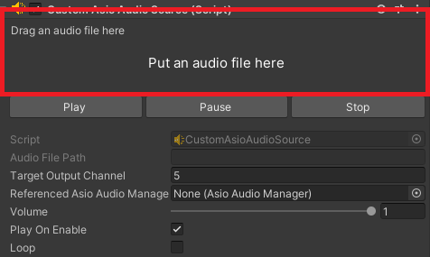

## CustomAsioAudioSource

The CustomAsioAudioSource component is designed to manage audio playback using the NAudio library in conjunction with an ASIO driver. It provides functionality for loading, configuring, and controlling audio files, while integrating with an [AsioAudioManager](/Documentation~/Audio%20Components/AsioAudioManager.md) for playback coordination.

### Typical Workflow and Features

1. Audio File Setup: When the component is enabled, the audio file is opened, mixed down to mono, and resampled on the fly to the [AsioAudioManager](/Documentation~/Audio%20Components/AsioAudioManager.md)'s `TargetSampleRate`. Files can have any sample rate and bit depth: nothing is converted or written to disk. The file's own format is shown in the read-only properties (`SampleRate`, `Channels`, `BitsPerSample`...).
2. Playback:
    - The Play, Pause, Stop, Restart and Seek methods control playback instantly, without interrupting the other sources. Play, Pause and Stop fade in or out over 5 ms to avoid clicks.
    - `Volume` (applied smoothly), `Loop` (seamless) and `TargetOutputChannel` can be changed while playing, from code or from the Inspector.
    - `CurrentTimestamp` follows the position actually played by the ASIO driver. When a non-looping file reaches its end, the source stops and `OnStop` is triggered.
3. Integration: The component communicates with the [AsioAudioManager](/Documentation~/Audio%20Components/AsioAudioManager.md) to ensure proper playback synchronization and configuration.

#### Properties Setup

For each CustomAsioAudioSource component, you can attach an audio file. For this, simply drag and drop an audio file from your project's *Assets* folder to the box (highlighted below) on the Inspector tab:



By dropping the audio file (or picking one with the *Browse…* button), you should see the file name in the box, along with its length and format. Files inside the project are stored with a project-relative path; files outside the project work in the Editor but are not copied to builds.

The Inspector also shows:
- **Playback**: the status and a progress bar (click or drag it to seek in Play mode), and Play / Pause / Stop buttons (enabled in Play mode).
- **Output**: the output channel, picked from a list of the driver's channels showing which ones are already used (with a warning on conflicts), the volume with a level meter in Play mode, and Mute / Solo.

All the sources of the scene can also be controlled side by side from the mixer window (*AsioAudioUnity > ASIO Mixer*, or *Window > Audio > ASIO Mixer*).
> **Warning:** The accepted audio file formats are: .mp3, .wav, .ogg, .aiff, .flac, but **only .wav has been tested for now**. So please note it is quite likely that the other formats may not work at this moment!

Next, fill in the `TargetOutputChannel` so it is valid (from 1 to the available number of channels on the ASIO driver) and unique among the other CustomAsioAudioSource components.

It is not mandatory to set the `ReferencedAsioAudioManager` as it will be automatically set if empty after starting the application (provided that there is one on scene).

Set the other properties (`Volume`, `PlayOnEnable`, `Loop`) so it matches what you want.

#### Script Example

```cs
using UnityEngine;
using AsioAudioUnity;

public class PlayAsioSourceAndLoop : MonoBehaviour
{
    private void Start()
    {
        CustomAsioAudioSource audioSource = gameObject.AddComponent<CustomAsioAudioSource>();
        audioSource.AudioFilePath = "path/to/audio/file.wav";
        audioSource.Volume = 0.8f;
        audioSource.Loop = true;
        audioSource.Play();
    }
}
```

#### Public Properties

| **Property** | **Description** |
|-|-|
| `AudioFilePath` | The path to the audio file to be played, relative to the project folder (e.g. `Assets/Sounds/file.wav`) or absolute. Changing it at runtime stops the source and loads the new file. |
| `ResolvedAudioFilePath` | The full path of the audio file: relative paths are resolved from the project folder in the Editor, and from the player's folder in builds (Read Only). |
| `TargetOutputChannel` | The output channel for the audio source (from 1 to the ASIO driver's output channel count, unique among sources). Can be changed while playing. |
| `ReferencedAsioAudioManager` | The AsioAudioManager managing this audio source. |
| `Volume` | The playback volume (range: 0.0 to 1.0), applied live. |
| `Mute` | Silences this source (smoothly) without stopping it or changing its volume. |
| `Solo` | When at least one source is soloed, only soloed sources are heard. |
| `MeterLevel` | The output level of this source (peak, 0.0 to 1.0, after volume and mute), with a meter-like falloff (Read Only). |
| `PlayOnEnable` | Whether playback starts automatically when the component is enabled. |
| `PreloadIntoMemory` | Decode the whole audio file into memory when it is loaded, instead of reading it from disk while playing. Avoids dropouts with many sources or slow disks, at the cost of memory (about 10 MB per minute of audio at 44.1 kHz) and a longer load. Can be switched while playing without interrupting playback. |
| `Loop` | Whether the audio should loop (seamlessly) when it reaches the end. |
| `AudioStatus` | The current playback status (`Stopped`, `Paused`, or `Playing`) (Read Only). |
| `CurrentTimestamp` | The current playback position in seconds (Read Only). |
| `AudioFileTotalLength` | The length of the audio file in seconds (Read Only). |

#### Public Methods

| **Method** | **Description** |
|-|-|
| `Play` | Starts playback of the audio file. |
| `Pause` | Pauses playback of the audio file. |
| `Stop` | Stops playback and resets the playback position. |
| `Restart` | Restarts playback from the beginning. |
| `Seek` | Moves the playback position, in seconds. Works while playing, paused or stopped. |

#### Unity Events

| **Event** | **Description** |
|-|-|
| `OnAudioFilePathChanged` | Triggered when the audio file path is updated. |
| `OnTargetOutputChannelChanged` | Triggered when the target output channel is updated. |
| `OnVolumeChanged` | Triggered when the playback volume is updated. |
| `OnPlay` | Triggered when playback starts. |
| `OnPause` | Triggered when playback is paused. |
| `OnStop` | Triggered when playback stops (when `Stop` is called, or when a non-looping file reaches its end). |

> **Note:** The ```Restart``` method doesn't trigger any events.
