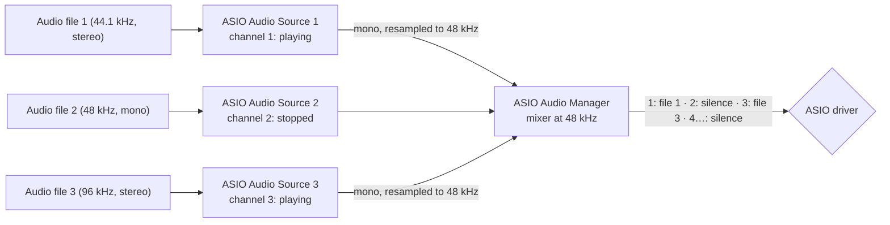

# AsioAudioManager

[Documentation home](/Documentation~/README.md) · Settings: [ASIO Audio Settings](/Documentation~/Reference/AsioAudioSettings.md)

The ASIO Audio Manager connects to the ASIO driver and plays all the [ASIO Audio Sources](/Documentation~/Reference/AsioAudioSource.md). **You don't add it to the scene**: it is created automatically when the first source is enabled (in Play mode or in a build), with the [project settings](/Documentation~/Reference/AsioAudioSettings.md), and kept across scene loads so the driver stays connected. In Play mode, it appears in the Hierarchy's *DontDestroyOnLoad* scene, with an Inspector showing its status (*Reconnect*, *Open Mixer*, *Settings*).

## How it plays the sources

- It keeps **one connection** to the driver, and continuously mixes all sources into it, each on its own output channel. Channels without a source are silent.
- The driver runs at one sample rate. Each source mixes its file down to mono and resamples it on the fly: files can have any sample rate and bit depth, and nothing is converted or written to disk.
- It checks that each source's output channel exists on the driver and is used by only one source.
- Playing, pausing, stopping, seeking, or changing a volume, a loop or an output channel is instant, and doesn't interrupt the other sources. Only changing the driver, sample rate or sample format reconnects the driver (sources keep their state and position).



## Transport in sync

`PlayAll`, `PauseAll`, `StopAll` and `RestartAll` change all sources **on the same sample**, so stems that belong together stay in sync. They are also on the *Master* strip of the [ASIO Audio Mixer](/Documentation~/Reference/AsioAudioMixer.md), in the overlay, and over OSC ([AsioOscRemote](/Documentation~/Reference/AsioOscRemote.md)). After each of them, the static `TransportCommandIssued` event is raised: the [REAPER Controller](/Documentation~/Reference/ReaperController.md) uses it to mirror Unity's transport in REAPER.

## Diagnostics

- If the driver is connected but doesn't ask for audio after 2 seconds (e.g. ReaRoute while REAPER's audio device is closed), a warning explains what to check. `RenderedFrames` stays at 0 in that case.
- If the driver stops because of an error in the audio callback, the error is logged.

## Script example

```cs
using UnityEngine;
using AsioAudioUnity;

public class ShowControl : MonoBehaviour
{
    public void StartShow()
    {
        AsioAudioManager manager = AsioAudioManager.Instance;
        manager.RecallSnapshot("Intro");
        manager.MasterVolumeDecibels = -6f;
        manager.RestartAll();   // all sources from the start, in sync
    }
}
```

## Properties

| **Property** | **Description** |
|-|-|
| `AsioAudioManager.Instance` | The manager (static). In Play mode or in a build, it is created if needed. Null in Edit mode. |
| `AsioAudioManager.Existing` | The manager if it exists, without creating it (static). |
| `Settings` | The ASIO Audio Settings in use (`AsioAudioSettings.Instance`). |
| `AsioDriverName`, `TargetSampleRate`, `TargetBitsPerSample` | The driver, sample rate and sample format (from the settings). Setting them reconnects the driver. |
| `MasterVolume`, `MasterVolumeDecibels` | The master volume, linear (0 to 1) or in dB (from the settings). Applied live and smoothly. |
| `MasterMeterLevel` | The level sent to the driver (peak of all channels, after the master volume), with a meter-like falloff (Read Only). |
| `IsConnected` | Whether the ASIO driver is connected and playing (Read Only). |
| `RenderedFrames` | How many frames the driver has asked for since it was connected: 0 if it doesn't process audio (Read Only). |
| `AsioDriverOutputChannelCount`, `AsioDriverInputChannelCount` | The driver's number of outputs (the highest valid output channel) and inputs (Read Only). |
| `AsioDriverSampleFormat` | The sample format the driver works with, e.g. `24-bit integer` (Read Only, empty until connected). |
| `AsioDriverOutputChannelNames`, `GetOutputChannelName(channel)` | The driver's names for its output channels, e.g. `ReaRoute Client=>REAPER 3` (Read Only). |
| `AsioAudioSources` | The sources playing through the manager (Read Only). |
| `Snapshots` | The saved snapshots (from the settings). |
| `DisplayInfoOnGameWindow`, `OverlayToggleKey`, `OverlayScale` | The in-game overlay settings (from the settings). |

## Methods

| **Method** | **Description** |
|-|-|
| `PlayAll`, `PauseAll`, `StopAll`, `RestartAll` | Transport of all sources, on the same sample. |
| `SaveSnapshot(name)` | Saves the mix of the loaded scenes as a snapshot (a snapshot with the same name is replaced). |
| `RecallSnapshot(name)`, `RecallSnapshot(index)` | Applies a snapshot (volume changes are smoothed while playing). Returns `false` if it doesn't exist. |
| `DeleteSnapshot(name)` | Deletes a snapshot. |
| `Reconnect` | Disconnects from the driver and connects again. Sources keep their state and position. |
| `RequestAddAsioAudioSource`, `RequestRemoveAsioAudioSource` | Used by the sources to register (you don't need to call them). |

## Events

| **Event** | **Description** |
|-|-|
| `AsioAudioManager.TransportCommandIssued` | Static. Raised after `PlayAll`, `PauseAll`, `StopAll` and `RestartAll` (and when the editor's Pause button pauses or resumes the sources), with the command. |
| `OnAsioDriverNameChanged`, `OnTargetSampleRateChanged`, `OnTargetBitsPerSampleChanged` | Raised when these settings are changed through the manager. |
