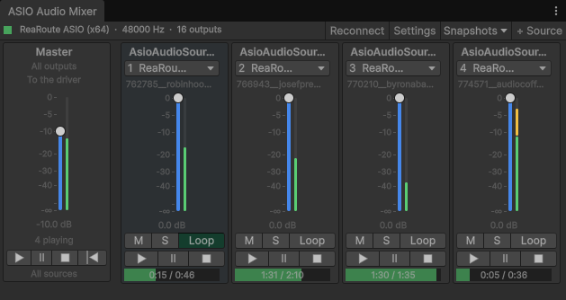
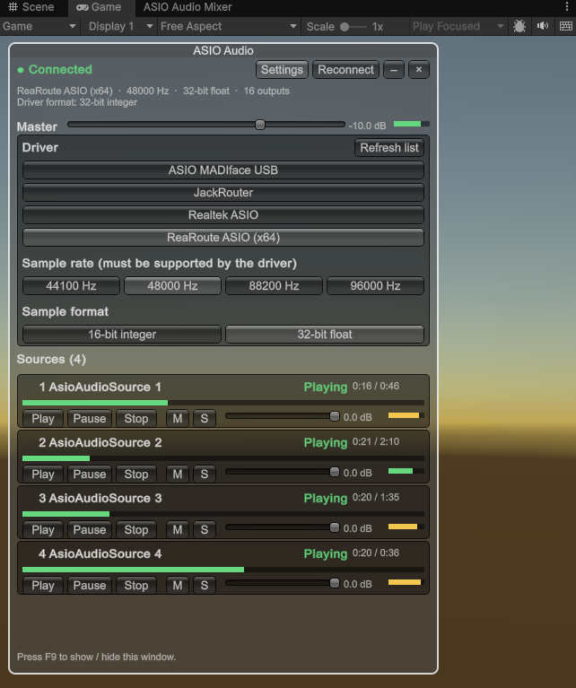

# ASIO Audio Mixer and in-game overlay

[Documentation home](/Documentation~/README.md)

Two places control all the sources of the scene side by side: the **ASIO Audio Mixer** window in the Editor, and the **in-game overlay** in the Game view and in builds.

## ASIO Audio Mixer

*AsioAudioUnity > ASIO Audio Mixer*, or *Window > Audio > ASIO Audio Mixer*.

### Toolbar

The driver status (driver, sample rate, number of outputs), **Reconnect**, **Settings** (opens *Project Settings > ASIO Audio*), **Snapshots** (save the current mix, recall or update a snapshot) and **+ Source** (creates an ASIO Audio Source on the next free channel).

### Master strip

The first strip: the **master volume** fader, with the level sent to the driver, and the transport of all sources, on the same sample: **▶** (Play All), **II** (Pause All), **■** (Stop All) and **|◀** (Restart All). Click *Master* to open the project settings.

### Source strips

One strip per ASIO Audio Source of the scene, highlighted when its GameObject is selected:

- its **name** (click to select it), dimmed if the source is inactive,
- its **output channel**, with the driver's name for it (e.g. *3  ReaRoute Client=>REAPER 3*). The menu also shows which channels other sources use. Channel conflicts are shown in red,
- its **file** (in red if not found),
- the **volume fader** with its dB scale and level meter (double-click: 0 dB),
- **M** (mute), **S** (solo) and **Loop**,
- **▶ II ■** (Play, Pause, Stop) and a **progress bar** (click to seek).

Long names, routes and file names are shortened with "…" (the tooltips show the full text). In Edit mode, the settings can be changed; the transport and meters work in Play mode.

## In-game overlay

A window in the Game view, also in builds, shown or hidden with the **Toggle Key** (F9 by default). Its settings are in *Project Settings > ASIO Audio > In-game Overlay*: **Show**, **Toggle Key** and **Scale** (e.g. 2 on a 4K screen).

- The connection status, **Reconnect**, collapse (**–**) and close (**×**).
- The **master volume**.
- **Settings**: the driver (from the drivers installed on the machine), the sample rate and the sample format, to set up a build on the show computer.
- The **sources**: channel, name, status, time, **Play / Pause / Stop**, **M** / **S** and volume.
