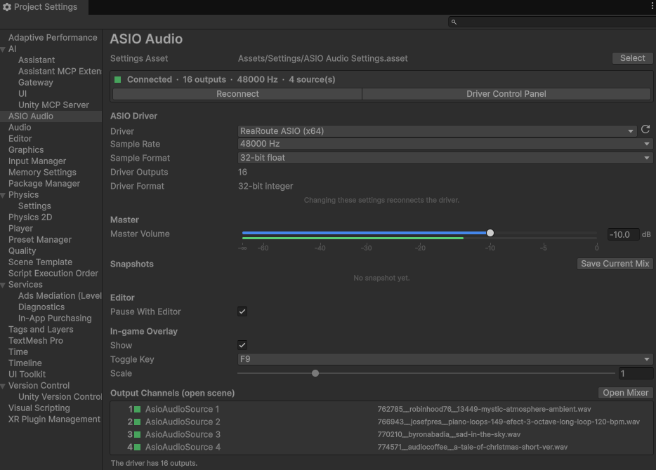

# ASIO Audio Settings

[Documentation home](/Documentation~/README.md) · Tutorial: [4. First play in Unity](/Documentation~/Tutorials/4-FirstPlay.md)

The ASIO settings are **project settings**, used by every scene: *Edit > Project Settings > ASIO Audio* (or *AsioAudioUnity > Project Settings…*).

The first time, click **Create ASIO Audio Settings**. The settings are saved in an `AsioAudioSettings` asset, `Assets/Settings/ASIO Audio Settings.asset`, which is added to the Player Settings' *Preloaded Assets* so builds use it too.

 ASIO Audio, connected to ReaRoute" width="700"/>

## Sections

| **Section** | **Settings** |
|-|-|
| Status | In Play mode: the connection status, number of outputs and sources, **Reconnect** and **Driver Control Panel** (the driver's own settings: buffer size, clock…). In Edit mode: **Driver Control Panel** too (see below). |
| ASIO Driver | **Driver**: one of the ASIO drivers installed on the machine (a driver set on another machine shows *(not installed)*). **Sample Rate**: must be supported by the driver (ReaRoute only accepts REAPER's); audio files are resampled to it. **Sample Format**: 32-bit float (recommended) or 16-bit integer. **Driver Outputs** and **Driver Format**: the driver's number of output channels and the sample format it actually works with (e.g. 24-bit integer), live when connected, otherwise remembered from the last time the driver was loaded. Changing the driver, rate or format in Play mode reconnects the driver; sources keep their state and position. |
| Master | **Master Volume**, in dB, applied to all sources after their own volume, with the level sent to the driver in Play mode. |
| Snapshots | Saved mixes: the master volume, and the volume, mute and solo of every source, **identified by output channel** (so a snapshot works in every scene). *Save Current Mix*, *Recall*, *Update*, rename and delete. |
| Editor | **Pause With Editor** (default: on): see below. |
| In-game Overlay | **Show**, **Toggle Key** (F9 by default) and **Scale** of the [in-game overlay](/Documentation~/Reference/AsioAudioMixer.md#in-game-overlay). |
| Output Channels | The sources of the open scene with their channel, status and file. Channel conflicts are shown, with **Fix**; **Open Mixer** opens the [ASIO Audio Mixer](/Documentation~/Reference/AsioAudioMixer.md). |

Changes made at runtime (from the overlay, the mixer, code or OSC) are made to the settings asset: in the Editor, they are kept after Play mode, like any asset edited in Play mode.

## Driver Control Panel in Edit mode

Outside Play mode, **Driver Control Panel** loads the driver to open its control panel. This also reads its number of outputs, channel names and sample format, shown as *Driver Outputs* and *Driver Format*. The driver is reloaded on each click (so changes made in its panel are read), and released with **Release Driver**, when leaving the page, entering Play mode or starting a preview. While it is loaded, other applications may not be able to use an exclusive driver.

## Pause With Editor

The ASIO audio runs on its own thread, so the editor's Pause button doesn't stop it. With **Pause With Editor**, pausing the editor in Play mode pauses the playing sources, on the same sample, and resuming plays the same sources again. Sources that were already paused or stopped aren't affected. The pause goes through `AsioAudioManager.TransportCommandIssued`, so applications following the transport pause and resume too (REAPER, with the [REAPER Controller](/Documentation~/Reference/ReaperController.md)'s *Follow Transport*).

## Scenes from before version 3.0

Scenes made with version 2.x contain an `AsioAudioManager` component with the settings. When such a scene is open, this page shows **Migrate the Scene's ASIO Audio Manager** (also in the component's Inspector): its driver, sample rate, format, master volume, overlay settings and snapshots are copied here, and the component is removed. Save the scene afterwards. Until then, the scene keeps working (if the project has no settings asset yet, the scene's manager uses its own settings, with a warning).

## From code

`AsioAudioSettings.Instance` gives the settings asset. Most settings are also on the [AsioAudioManager](/Documentation~/Reference/AsioAudioManager.md) (`AsioDriverName`, `TargetSampleRate`, `MasterVolume`, `Snapshots`…).

| **Property** | **Description** |
|-|-|
| `AsioDriverName`, `TargetSampleRate`, `TargetBitsPerSample` | The driver, sample rate and sample format. |
| `MasterVolume` | The master volume (linear gain, 0 to 1). |
| `Snapshots` | The saved snapshots (`AsioMixerSnapshot`). |
| `PauseWithEditor` | Pause the sources when the editor is paused (default: on). |
| `DisplayInfoOnGameWindow`, `OverlayToggleKey`, `OverlayScale` | The in-game overlay settings. |
