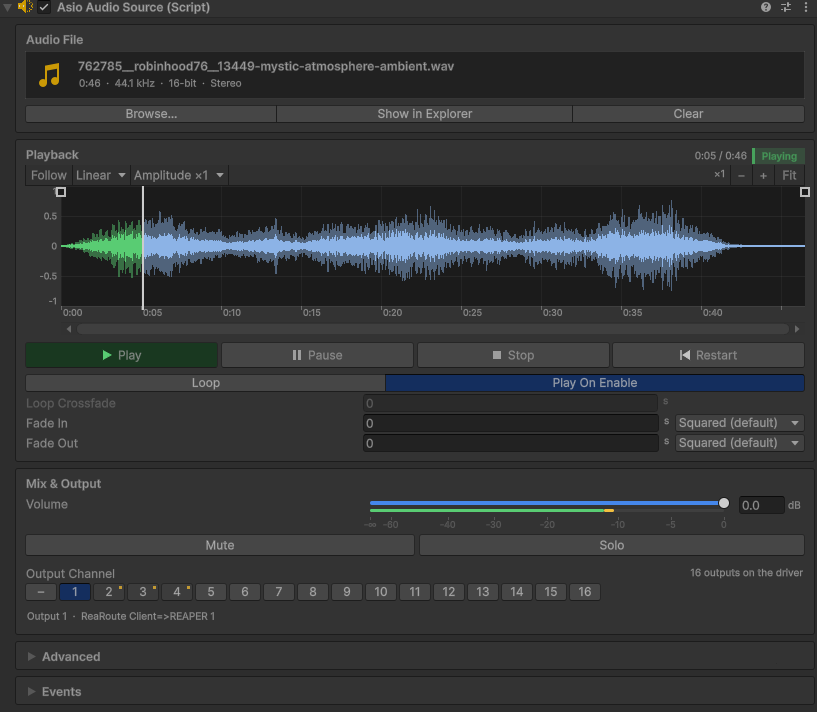
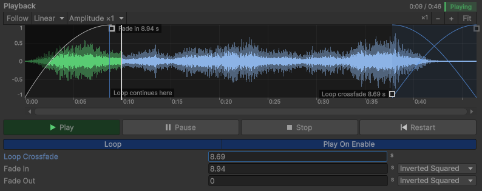

# AsioAudioSource

[Documentation home](/Documentation~/README.md) · Tutorial: [5. ASIO sources in your scene](/Documentation~/Tutorials/5-AddSources.md)

The ASIO Audio Source plays an audio file on **one output channel** of the ASIO driver, through the [ASIO Audio Manager](/Documentation~/Reference/AsioAudioManager.md) (created automatically). It replaces Unity's Audio Source: `AudioClip` becomes `AudioFilePath`, `PlayOnAwake` becomes `PlayOnEnable`, and each source has a `TargetOutputChannel`.

The file is opened when the source is enabled, mixed down to mono, and resampled on the fly to the project's sample rate. Nothing is converted or written to disk.

## Inspector

The Inspector is organised in cards.



**Audio File**: drop a file on the card, or click *Browse…*. It shows the file name, length and format, with *Show in Explorer* and *Clear*.

**Playback**:
- the status and time, with Play / Pause / Stop / Restart in Play mode, and **Preview** in Edit mode: plays the source through the project's driver without entering Play mode (on its output channel, at its volume and the master volume; one source at a time, stopped when entering Play mode),
- *Loop*, *Play On Enable*, *Loop Crossfade* (see [Smooth loop](#smooth-loop)), *Fade In* and *Fade Out* with their curves (see [Fades](#fades)),
- the waveform (see below).

**Mix & Output**:
- the volume in decibels: a fader with a dB scale and, in Play mode, the level meter (double-click the fader or use *0 dB* to reset it), and a field to type a value (`-6`, or `-inf` for silence),
- Mute and Solo,
- the output channel, in a grid of the driver's channels: channels used by other sources are marked with a dot (hover a channel to see which source uses it, and the driver's name for it, e.g. *ReaRoute Client=>REAPER 3*). The selected channel's name is shown under the grid. Conflicts show a warning.

**Advanced**: *Preload Into Memory*, the file's format, and how it is played (mixed down to mono, resampled to the project's sample rate).

**Events**: the `OnPlay`, `OnPause` and `OnStop` UnityEvents.

### Waveform

The waveform shows the file mixed down to mono, as it is played. It is analysed in the background the first time the file is shown.



- A time ruler, and an amplitude scale in linear or dB (dB shows quiet passages better).
- The peak level (light) and the RMS level (solid). Hovering shows the time and the levels under the mouse.
- The playhead, with the part already played highlighted. Click or drag to seek (in Play mode or during a preview).
- Zoom with *Ctrl + mouse wheel* (or *−* / *+* / *Fit*), scroll with *Shift + mouse wheel*, middle-drag or the scrollbar. *Follow* keeps the playhead in view, and the amplitude zoom (×1 to ×16) helps with quiet files.
- The fades, drawn like REAPER's item fades, with the attenuated part shaded. Drag the handles at the top to change their durations (double-click: no fade), and right-click a fade to choose its curve. When *Loop* is on, the fade-out is dimmed (it then only applies to Pause and Stop).
- When *Loop* is on, the loop crossfade, drawn over the end of the file, with a handle at the bottom to drag its duration (double-click: none), and a line where each loop continues.

## Fades

Play, Pause and Stop fade in or out: over 5 ms by default (just enough to avoid clicks), or over the **Fade In** / **Fade Out** durations. The status changes immediately and the sound fades afterwards. The fade-out also applies when a non-looping file reaches its end, like an item fade-out in REAPER.

Each fade has a **curve** (`AsioFadeCurve`), chosen next to its duration or with a right-click on the fade in the waveform (*Apply to both fades* copies it to the other one). A fade-out uses the mirrored shape of the fade-in of the same name.

| **Curve** | **Gain** (x: 0 at silence, 1 at full volume) | **Sounds** |
|-|-|-|
| *Squared* (default) | x² | Gentle near silence: smoother than linear. |
| *Linear* | x | A constant change of amplitude: abrupt near silence. |
| *Inverted Squared* | 1 − (1 − x)² | Fast near silence, gentle near full volume. |
| *S-Curve* | (1 − cos(πx)) / 2 | Gentle at both ends. |

When a fade changes direction halfway (a Pause during a fade-in, for example), it continues from the same level, without a jump.

## Smooth loop

With *Loop* on, the file restarts seamlessly at its end. If its end and its start don't match (an ambience, a texture, a recording that wasn't cut to loop), the jump can be heard: set a **Loop Crossfade** duration. Over the last seconds of the file, its end fades out while its start fades in, and each loop then continues from that time, so the loop point is never heard.

- The crossfade is equal-power, which keeps the loudness constant for most material.
- It is at most half the file. A loop then lasts the file's length minus the crossfade. The first play starts at the beginning of the file.
- It is done before resampling, at the sample, so the loop stays seamless at any output sample rate. The start of the file is kept in memory (a few seconds of mono audio), also for streamed files.
- The playback position (`CurrentTimestamp`, the playhead) loops too, and *Fade Out* still applies to Pause and Stop.

## Volume

`Volume` is the linear gain applied to the samples: 0.5 is -6 dB. What we hear follows decibels: -6 dB is clearly quieter, and about -10 dB sounds half as loud. That's why the faders work in decibels, with a mixing-desk law (half the fader travel is -20 dB). Use `VolumeDecibels` to set the volume in decibels from code.

## Audio files

- **Formats**: WAV, AIFF, MP3 and FLAC (MP3 and FLAC are decoded by Windows; FLAC needs Windows 10 or later). **OGG isn't supported**: convert it to WAV or FLAC.
- **Paths**: files inside the project are stored with a path from the project folder (`Assets/Sounds/rain.wav`); files outside the project are stored with their full path, and work in the Editor only.
- **Builds**: the files used by the sources of the built scenes are copied next to the player, at the same relative path. Files set from code at runtime must be copied yourself.
- **Moved files**: when a scene is opened in the Editor, sources whose file is missing are relinked to a file with the same name under the scene's folder (if there is exactly one), and this is logged.
- **Large files or many sources**: *Preload Into Memory* decodes the whole file when it is loaded, instead of reading it from disk while playing.

## Script example

```cs
using UnityEngine;
using AsioAudioUnity;

public class PlayAsioSourceAndLoop : MonoBehaviour
{
    private void Start()
    {
        AsioAudioSource source = gameObject.AddComponent<AsioAudioSource>();
        source.AudioFilePath = "Assets/Sounds/rain.wav";
        source.TargetOutputChannel = 5;
        source.VolumeDecibels = -6f;        // same as Volume = 0.5f
        source.Loop = true;
        source.LoopCrossfadeDuration = 2f;  // hides the loop point
        source.Play();
    }
}
```

## Properties

| **Property** | **Description** |
|-|-|
| `AudioFilePath` | The audio file: a path from the project folder (e.g. `Assets/Sounds/file.wav`) or a full path. Changing it at runtime stops the source and loads the new file. |
| `ResolvedAudioFilePath` | The full path of the file: resolved from the project folder in the Editor, from the player's folder in builds (Read Only). |
| `TargetOutputChannel` | The output channel, from 1 to the driver's number of outputs, unique among sources. Can be changed while playing. |
| `ReferencedAsioAudioManager` | The ASIO Audio Manager this source plays through, set when the source is enabled in Play mode (Read Only). |
| `Volume` | The linear gain (0 to 1; 0.5 is -6 dB), applied live and smoothly. |
| `VolumeDecibels` | The same volume in decibels (0 dB: the file's level; negative infinity: silence). |
| `Mute` | Silences the source (smoothly) without stopping it or changing its volume. |
| `Solo` | When at least one source is soloed, only soloed sources are heard. |
| `MeterLevel` | The source's output level (peak, 0 to 1, after volume and mute), with a meter-like falloff (Read Only). |
| `PlayOnEnable` | Starts playing when the component is enabled. |
| `PreloadIntoMemory` | Decodes the whole file into memory when it is loaded, instead of reading it from disk while playing. Avoids dropouts with many sources or slow disks, at the cost of memory (about 10 MB per minute at 44.1 kHz) and a longer load. Can be switched while playing. |
| `Loop` | Loops (seamlessly) at the end of the file. |
| `LoopCrossfadeDuration` | When looping, crossfades the end of the file with its start over this many seconds (at most half the file). 0: the file restarts directly. |
| `FadeInDuration` | Fade-in of `Play` (and of resuming), in seconds. 0: 5 ms. |
| `FadeOutDuration` | Fade-out of `Pause`, `Stop` and the end of a non-looping file, in seconds. 0: 5 ms on Pause and Stop, and no fade at the end of the file. |
| `FadeInCurve`, `FadeOutCurve` | The shape of each fade (`AsioFadeCurve`). `AsioFadeCurves.Evaluate(curve, x)` gives the gain of a curve. |
| `AudioStatus` | `Stopped`, `Paused` or `Playing` (Read Only). |
| `CurrentTimestamp` | The playback position in seconds, as played by the driver (Read Only). |
| `AudioFileTotalLength` | The length of the file in seconds (Read Only). |
| `Channels`, `SampleRate`, `BitsPerSample`… | The file's own format (Read Only). |

## Methods

| **Method** | **Description** |
|-|-|
| `Play` | Starts or resumes playing. |
| `Pause` | Pauses. |
| `Stop` | Stops and goes back to the start of the file. |
| `Restart` | Plays from the start of the file. |
| `Seek(seconds)` | Moves the playback position, while playing, paused or stopped. |

To change several sources **in sync** (on the same sample), use the manager's `PlayAll`, `PauseAll`, `StopAll` and `RestartAll`.

## Events

| **Event** | **Description** |
|-|-|
| `OnPlay` | Playback starts. |
| `OnPause` | Playback is paused. |
| `OnStop` | Playback stops: `Stop` is called, or a non-looping file reaches its end. |
| `OnAudioFilePathChanged` | The audio file path changes. |
| `OnTargetOutputChannelChanged` | The output channel changes. |
| `OnVolumeChanged` | The volume changes. |

`Restart` doesn't raise any event.
