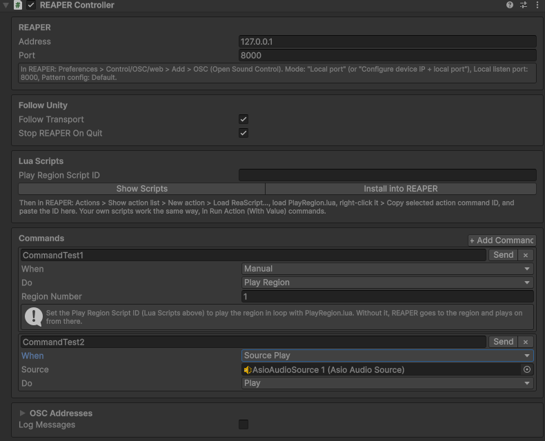

# ReaperController

[Documentation home](/Documentation~/README.md) · Tutorial: [7. Control REAPER from Unity](/Documentation~/Tutorials/7-ControlReaper.md)

> Part of the **REAPER OSC plugin** (`Modules/ReaperOsc`, assembly `AsioAudioUnity.ReaperOsc`). Menu: *GameObject > AsioAudioUnity > REAPER Controller*.

The REAPER Controller controls REAPER from Unity with OSC messages:

- it **follows Unity's transport**: when the scene starts with sources playing (*Play On Enable*), REAPER plays from the start of the project; `PlayAll`, `PauseAll`, `StopAll` and `RestartAll` of the [ASIO Audio Manager](/Documentation~/Reference/AsioAudioManager.md) play, pause, stop and restart REAPER, and so does the editor's Pause button (with *Pause With Editor*),
- it sends **commands**: play, stop, go to a time, a marker or a region, play a region in loop, run any REAPER action or Lua script (with a value if needed), or any OSC message,
- commands are sent **automatically on Unity events** (scene start, `PlayAll`…, a given source playing, pausing or stopping), **from scripts or UnityEvents** (`Trigger("name")`), or with the Inspector's **Send** button (also in Edit mode, to test).

REAPER needs an OSC control surface listening on the controller's port: *Options > Preferences > Control/OSC/web > Add > OSC*, local listen port **8000**, pattern config **Default**. No OSC Manager is needed in Unity.



## Commands

Each command of the **Commands** list has:

| **Field** | **Description** |
|-|-|
| Name | Used to send it from code or a UnityEvent: `Trigger("name")`. |
| When | `Manual` (only when called), `SceneStart`, `PlayAll`, `PauseAll`, `StopAll`, `RestartAll`, or `SourcePlay` / `SourcePause` / `SourceStop` (with a **Source**: an ASIO Audio Source). |
| Do | What REAPER does (see below). |

| **Do** | **Settings** | **OSC message sent** |
|-|-|-|
| Play / Pause / Stop / Record | | `/play`, `/pause`, `/stop`, `/record` |
| Go To Start | | `/time 0` |
| Go To Time | Time (s) | `/time [seconds]` |
| Go To Marker | Marker Number | `/marker [number]` |
| Go To Region | Region Number | `/region [number]` |
| Play Region | Region Number | `/action/[PlayRegion.lua ID] "[number]"`: plays the region in loop (without the script: `/region [number]` then `/play`) |
| Run Action | Command ID | `/action [id]` for a numeric ID (e.g. `40042`), `/action/str "[id]"` for a named ID (e.g. `_RS7d3c…`, `_SWS_…`) |
| Run Action With Value | Command ID, Value | `/action/[id] "[value]"`: the script reads the value with `reaper.get_action_context()` |
| Custom Message | OSC Address, Value | `[address] [value]`, e.g. `/track/1/mute 1` |

A command ID is found in REAPER's action list (*Actions > Show action list*): right-click an action > *Copy selected action command ID*.

The addresses are those of REAPER's *Default* OSC pattern. If your control surface uses another pattern file, change them in the **OSC Addresses** card.

## Lua scripts

The plugin comes with **PlayRegion.lua** (`Modules/ReaperOsc/Lua Scripts`), used by *Play Region* commands: it receives the region number from the OSC message, sets the time selection to the region, turns repeat on, and plays it.

1. In the Inspector, click **Install into REAPER**: the scripts are copied to `%APPDATA%\REAPER\Scripts\AsioAudioUnity` (or **Show Scripts** to copy them yourself, e.g. for a portable REAPER).
2. In REAPER: *Actions > Show action list > New action > Load ReaScript…*, and select `PlayRegion.lua`.
3. Right-click it > *Copy selected action command ID*, and paste it in **Play Region Script ID**.

Your own scripts work the same way, with *Run Action* or *Run Action With Value* commands. A script reads the value sent with it from its action context:

```lua
local _, _, _, _, _, _, _, context = reaper.get_action_context()
local value = context:match(":s=([^%]]+)")  -- the value sent by Unity, as a string
```

## Script example

```cs
using UnityEngine;
using AsioAudioUnity;

public class ReaperCues : MonoBehaviour
{
    [SerializeField] private ReaperController _reaper;

    public void OnVisitorEntersRoom()
    {
        _reaper.PlayRegion(2);          // plays region 2 in loop (with PlayRegion.lua)
    }

    public void OnShowEnds()
    {
        _reaper.Trigger("Outro");       // a command named "Outro" in the Inspector
        _reaper.RunAction(40042);       // Transport: Go to start of project
    }
}
```

`Trigger(string)` can also be called from a UnityEvent in the Inspector (e.g. a source's `OnPlay`).

## Properties

| **Property** | **Description** |
|-|-|
| `ReaperAddress` | IP address of the computer running REAPER (default: 127.0.0.1). |
| `ReaperPort` | The local listen port of REAPER's OSC control surface (default: 8000). |
| `FollowTransport` | Mirrors `PlayAll` / `PauseAll` / `StopAll` / `RestartAll` and the editor's Pause button in REAPER, and plays REAPER from the start of the project when the scene starts with sources playing (default: on). Sources played one by one (`AsioAudioSource.Play`) aren't mirrored: use *SourcePlay* commands for that. |
| `StopReaperOnQuit` | Stops REAPER when the application quits or Play mode ends (default: on). Commands triggered by sources stopping while quitting aren't sent. |
| `PlayRegionScriptId` | The command ID of PlayRegion.lua in REAPER (e.g. `_RS7d3c…`). |
| `Commands` | The list of commands (`ReaperCommand`). |
| `Addresses` | The OSC addresses REAPER answers to (`ReaperOscAddresses`). |
| `LogMessages` | Logs every message sent. |

## Methods

| **Method** | **Description** |
|-|-|
| `Play`, `Pause`, `Stop`, `Record` | REAPER's transport. |
| `GoToStart`, `GoToTime(seconds)` | Moves the edit cursor (and playback, if playing). |
| `GoToMarker(number)`, `GoToRegion(number)` | Goes to a marker, or to the start of a region. |
| `PlayRegion(number)` | Plays a region in loop (with PlayRegion.lua). |
| `RunAction(id)` | Runs an action or script, by numeric or named command ID. |
| `RunActionWithValue(id, value)` | Runs an action or script with a value. |
| `Trigger(name)`, `Trigger(index)` | Sends a command of the list. |
| `Execute(command)` | Sends a `ReaperCommand`. |
| `Send(address, values...)` | Sends any OSC message to REAPER (int, float or string values). |
