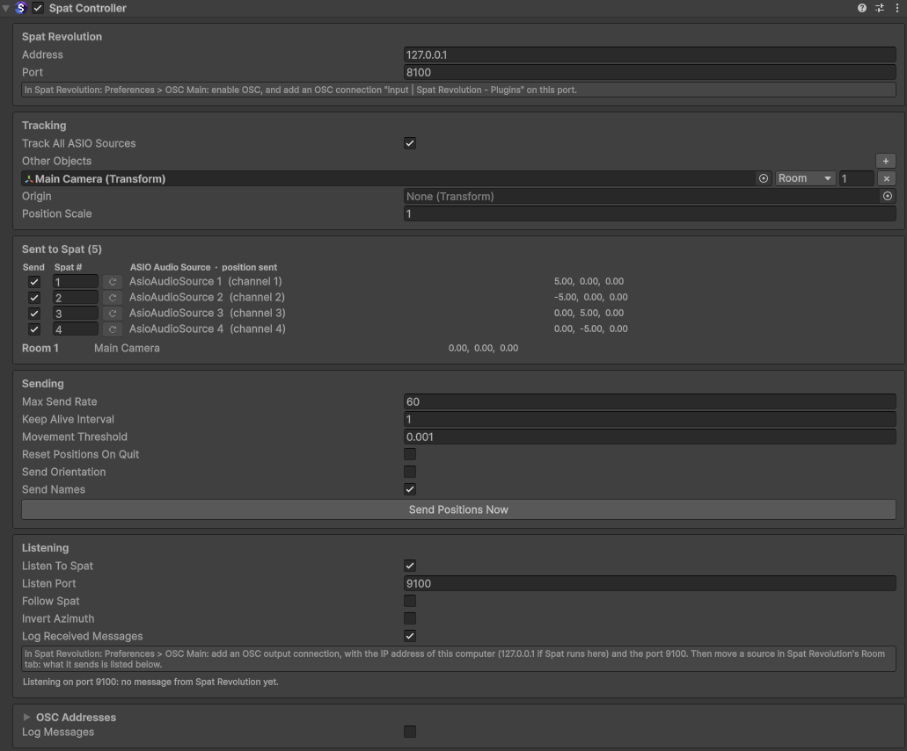

# SpatController

[Documentation home](/Documentation~/README.md) · Tutorial: [6. Send positions to Spat Revolution](/Documentation~/Tutorials/6-SendPositionsToSpat.md)

> Part of the **Spat OSC plugin** (`Modules/SpatOsc`, assembly `AsioAudioUnity.SpatOsc`). Menu: *GameObject > AsioAudioUnity > Spat Controller*.

The Spat Controller sends the positions of the sound sources and rooms to **Spat Revolution** over OSC, from a single component:

- **every ASIO Audio Source is tracked automatically**, as the Spat source numbered like its **output channel** (the ReaRoute input / REAPER track it arrives on), so Unity, REAPER and Spat use the same numbers,
- **other objects** can be added: rooms, or sources that aren't ASIO Audio Sources,
- positions are sent when objects move (at most *Max Send Rate* times per second), re-sent every *Keep Alive Interval* seconds, and converted from Unity's axes (Y up) to Spat's (Z up), relative to an optional **Origin**.

It sends directly to Spat Revolution's address and port: no OSC Manager and no component on each source are needed. It works alongside the [REAPER Controller](/Documentation~/Reference/ReaperController.md), each sending to its own application.

## Inspector



- **Spat Revolution**: **Address** and **Port** (127.0.0.1:8100 by default).
- **Tracking**: **Track All ASIO Sources**, **Other Objects** (a table: **+** adds an object, each row has its Target, Type *Source* or *Room*, number in Spat, and **×** to remove it), **Origin** and **Position Scale**.
- **Sent to Spat**: the table of what is tracked, with the position sent. For each ASIO Audio Source: **Send** (untick to stop sending it), **Spat #** (any number; the reset button goes back to the output channel) and its name and channel. Two sources with the same Spat number show a warning.
- **Sending**: **Max Send Rate**, **Keep Alive Interval**, **Movement Threshold**, **Reset Positions On Quit**, **Send Orientation** (with **Invert Yaw** and **Rotation Threshold**, see [Orientation](#orientation)), **Send Names** (see [Names](#names)), and **Send Positions Now** (also in Edit mode, to check the setup; it sends the names too).
- **Listening**: **Listen To Spat**, with **Listen Port**, **Follow Spat**, **Invert Azimuth** and **Log Received Messages**, and the list of what Spat Revolution has sent (see [Listening to Spat Revolution](#listening-to-spat-revolution)).
- **OSC Addresses**: the addresses of Spat Revolution, and **Log Messages**.

## Messages

| **Address** | **Values** |
|-|-|
| `/source/[number]/xyz` | x, y, z (Spat's axes: Unity's x, z, y) |
| `/room/[number]/xyz` | x, y, z |
| `/source/[number]/yaw` | yaw, in degrees (with *Send Orientation*) |
| `/source/[number]/pitch` | pitch, in degrees (with *Send Orientation*) |
| `/source/[number]/name` | the source's name (with *Send Names*) |

The addresses can be changed in the *OSC Addresses* card (`{0}` is the number).

## Names

With **Send Names** (default: on), each Spat source is named like its Unity object (the GameObject of the ASIO Audio Source, or the target of an *Other Objects* entry), so the sources are easy to tell apart in Spat Revolution. Names are sent when Play mode starts, when an object is renamed, and with *Send Positions Now*. The default address is `/source/{0}/name`: if Spat Revolution doesn't rename its sources, check it against your version's OSC documentation and change it in *OSC Addresses*, or untick *Send Names*.

## Orientation

With **Send Orientation**, the Spat Controller also sends the orientation of each source, for directivity in Spat Revolution: its **yaw** and **pitch**, in degrees, relative to the *Origin*.

- Yaw 0 faces the Origin's forward (Unity's +Z), and is positive turning right seen from above. If sources turn the wrong way in Spat Revolution, tick **Invert Yaw**. Pitch is positive upwards.
- The orientation is sent when the object rotates by more than *Rotation Threshold* (0.5° by default), with the keep-alive, and with *Send Positions Now*. Rooms only send their position.
- The default addresses are `/source/{0}/yaw` and `/source/{0}/pitch`: check them against your version of Spat Revolution's OSC documentation, and change them in *OSC Addresses* if needed.
- The source's volume isn't sent as Spat gain: Unity already applies it to the audio, so it would apply twice.

## Listening to Spat Revolution

By default, Unity only sends to Spat Revolution, and can't tell whether it receives anything. With **Listen To Spat** (default: off), the Spat Controller also receives the messages Spat Revolution sends, in Play mode and in Edit mode:

1. Tick **Listen To Spat**, and keep the **Listen Port** (9100), or choose another free port (not Spat Revolution's input port).
2. In Spat Revolution, *Preferences > OSC Main*: add an OSC **output** connection, with the IP address of the computer running Unity (127.0.0.1 if it is the same) and the listen port.
3. Move a source in Spat Revolution's *Room* tab.

The Inspector lists each address received, with its number of messages and the latest values of each kind it received, by value types (e.g. `f f f: 30.5 0 2 | s: "release"`; a green dot: received in the last half second). **Copy** copies the list, **Clear** empties it. With **Log Received Messages** (default: on), the Console shows each address the first time, then at most once per second (300 lines per session at most). The Setup Check shows whether Spat Revolution answers. Scripts can use the messages with the `MessageReceived` event.

Spat Revolution sends, among others: `/source/[number]/aed` (azimuth, elevation, distance) while a source is dragged, then `"release"` when it is let go; `/source/[number]/gain`; `/source/[number]/select`; and echoes of what Unity sends (names, and positions as *aed*). What it sends exactly depends on its version and OSC output settings.

### Follow Spat

Without it, Unity drives the positions: a source moved in Spat Revolution goes back to its Unity position on the next message Unity sends (at the latest after *Keep Alive Interval*). With **Follow Spat** (default: off, needs *Listen To Spat*):

- A source or room moved in Spat Revolution **moves in Unity too** (only objects whose position Unity sends, by their Spat number), converted back to Unity's coordinates (*Origin*, *Position Scale*).
- While it is dragged in Spat Revolution (until *release*, or half a second without a move), **Unity doesn't send it back**. If Unity moves it at the same time (e.g. an animation), Unity keeps control.
- **In Edit mode**, the move is recorded with **Undo** (one step per drag), and is kept in the scene: sources can be placed by ear from Spat Revolution. In Play mode, the move is lost when Play mode ends, like any change made in Play mode.
- **Echoes** of the positions Unity sends are recognised (within 1 cm, or 0.5 % of the distance) and ignored, so Unity doesn't follow itself. The Inspector counts the echoes ignored and the moves applied.

**Azimuth convention**: Unity reads Spat Revolution's azimuth as 0 in front (the Origin's forward), positive to the right seen from above, and elevation positive upwards. If the echoes only match Unity's positions with the azimuth inverted, the Inspector and the Setup Check say so, with an **Invert Azimuth** button: without it, moves made in Spat would be mirrored left/right in Unity.

## Script example

```cs
using UnityEngine;
using AsioAudioUnity;

public class AddRoom : MonoBehaviour
{
    [SerializeField] private SpatController _spat;
    [SerializeField] private Transform _room;
    [SerializeField] private AsioAudioSource _narrator;

    private void Start()
    {
        _spat.TrackedObjects.Add(new SpatTrackedObject { Target = _room, Type = SpatObjectType.Room, Index = 1 });
        _spat.SetSpatIndex(_narrator, 10);   // sent as Spat source 10 instead of its output channel
    }
}
```

## Properties

| **Property** | **Description** |
|-|-|
| `SpatAddress`, `SpatPort` | Where Spat Revolution listens (default: 127.0.0.1:8100). |
| `TrackAllSources` | Sends the position of every ASIO Audio Source, as the Spat source numbered like its output channel (default: on). |
| `SourceMappings` | ASIO Audio Sources sent with another Spat number, or not sent (`SpatSourceMapping`: `Source`, `SpatIndex`, `Send`). Sources without an entry use their output channel. |
| `TrackedObjects` | Other objects (`SpatTrackedObject`: `Target`, `Type` *Source* or *Room*, `Index`). An entry with the same type and number as an ASIO source replaces it. |
| `Origin`, `PositionScale` | Positions are sent relative to the origin (its position, rotation and scale), multiplied by the scale. |
| `MaxSendRate` | Maximum number of messages per second, per object (default: 60; 0: no limit). |
| `KeepAliveInterval` | Positions are re-sent every this many seconds even if nothing moves (default: 1; 0: only on movement). |
| `MovementThreshold` | Smallest movement that sends a new position (default: 0.001). |
| `ResetPositionsOnQuit` | Sends (0, 0, 0) for every tracked object when the application quits or Play mode ends (default: off). |
| `SendOrientation` | Also sends the yaw and pitch of the sources (default: off). |
| `InvertYaw` | Inverts the sign of the yaw sent (default: off). |
| `RotationThreshold` | Smallest rotation, in degrees, that sends a new orientation (default: 0.5). |
| `SendNames` | Names each Spat source like its Unity object (default: on). |
| `Addresses` | The OSC addresses of Spat Revolution. |
| `LogMessages` | Logs every message sent. |
| `ListenToSpat`, `ListenPort` | Receives the messages Spat Revolution sends to this port, in Play mode (default: off, 9100). See [Listening to Spat Revolution](#listening-to-spat-revolution). |
| `FollowSpat` | A source or room moved in Spat Revolution moves in Unity too (with *Listen To Spat*; default: off). See [Follow Spat](#follow-spat). |
| `InvertAzimuth` | Reads Spat Revolution's azimuth as positive to the left (default: off). |
| `EchoCount`, `AppliedMoveCount`, `AzimuthLooksInverted` | Echoes of Unity's positions ignored, moves from Spat applied, and whether the echoes suggest *Invert Azimuth* (Read Only). |
| `LogReceivedMessages` | Logs the messages received: each address the first time, then at most once per second (default: on). |
| `IsListening`, `ListenError` | Whether the listen port is open, or why it couldn't be opened (Read Only). |
| `HasHeardFromSpat`, `ReceivedMessageCount` | Whether Spat Revolution has sent a message since Unity started listening, and how many (Read Only). |
| `ReceivedAddresses` | Each address received, with its number of messages, last values, latest values of each kind (`Variants`) and time (`ReceivedAddress`, Read Only). |
| `MessageReceived` | Event raised on the main thread for each message received from Spat Revolution (`OscMessage`). |

## Methods

| **Method** | **Description** |
|-|-|
| `SendAllPositions()` | Sends the position of everything tracked now. |
| `GetSpatIndex(source)`, `SetSpatIndex(source, number)`, `GetMapping(source)` | The Spat number of an ASIO Audio Source (its mapping, or its output channel), and how to change it. |
| `SendPosition(type, number, spatPosition)` | Sends a position, in Spat's coordinates. |
| `SendSourceOrientation(number, yawPitch)` | Sends the yaw and pitch of a source, in degrees. |
| `SendSourceNames(all)`, `SendSourceName(number, name)` | Sends the names of the tracked sources (all, or only those renamed since), or one name. |
| `ToSpatOrientation(worldRotation)` | Converts a Unity rotation to Spat's yaw and pitch (relative to the Origin). |
| `ToSpatPosition(worldPosition)` | Converts a Unity position to Spat's coordinates (origin, scale, axes). |
| `GetTrackedPositions()` | What is tracked now. |
| `RefreshSources()` | Finds the ASIO Audio Sources of the loaded scenes again. |
| `Send(address, values...)` | Sends any OSC message to Spat Revolution. |
| `FromSpatPosition(spatPosition)`, `AedToSpatPosition(aed)` | Converts Spat coordinates to a Unity position (the inverse of `ToSpatPosition`), and Spat's azimuth, elevation, distance to its x, y, z. |
| `IsHeldBySpat(type, number)` | Whether an object is being dragged in Spat Revolution now (Follow Spat). |
| `ClearReceivedMessages()`, `DescribeReceivedMessages()` | Forgets the messages received, or lists them as text (one address per line). |
