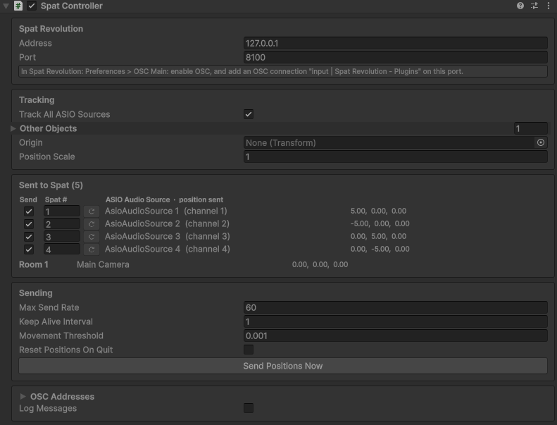

# SpatController

[Documentation home](/Documentation~/README.md) · Tutorial: [6. Send positions to Spat Revolution](/Documentation~/Tutorials/6-SendPositionsToSpat.md)

> Part of the **Spat OSC plugin** (`Modules/SpatOsc`, assembly `AsioAudioUnity.SpatOsc`). Menu: *GameObject > AsioAudioUnity > Spat Controller*.

The Spat Controller sends the positions of the sound sources and rooms to **Spat Revolution** over OSC, from a single component:

- **every ASIO Audio Source is tracked automatically**, as the Spat source numbered like its **output channel** (the ReaRoute input / REAPER track it arrives on), so Unity, REAPER and Spat use the same numbers,
- **other objects** can be added: rooms, or sources that aren't ASIO Audio Sources,
- positions are sent when objects move (at most *Max Send Rate* times per second), re-sent every *Keep Alive Interval* seconds, and converted from Unity's axes (Y up) to Spat's (Z up), relative to an optional **Origin**.

It sends directly to Spat Revolution's address and port: no OSC Manager and no component on each source are needed. It works alongside the [REAPER Controller](/Documentation~/Reference/ReaperController.md), each sending to its own application.

## Inspector



- **Spat Revolution**: **Address** and **Port** (127.0.0.1:8100 by default).
- **Tracking**: **Track All ASIO Sources**, **Other Objects** (each with a Target, a Type, *Source* or *Room*, and its number in Spat), **Origin** and **Position Scale**.
- **Sent to Spat**: the table of what is tracked, with the position sent. For each ASIO Audio Source: **Send** (untick to stop sending it), **Spat #** (any number; the reset button goes back to the output channel) and its name and channel. Two sources with the same Spat number show a warning. Sources that also have an obsolete *Source Position OSC* component are reported, since their positions would be sent twice, with a button to remove those components.
- **Sending**: **Max Send Rate**, **Keep Alive Interval**, **Movement Threshold**, **Reset Positions On Quit**, and **Send Positions Now** (also in Edit mode, to check the setup).
- **OSC Addresses**: the addresses of Spat Revolution, and **Log Messages**.

## Messages

| **Address** | **Values** |
|-|-|
| `/source/[number]/xyz` | x, y, z (Spat's axes: Unity's x, z, y) |
| `/room/[number]/xyz` | x, y, z |

The addresses can be changed in the *OSC Addresses* card (`{0}` is the number).

## Script example

```cs
using UnityEngine;
using AsioAudioUnity;

public class AddRoom : MonoBehaviour
{
    [SerializeField] private SpatController _spat;
    [SerializeField] private Transform _room;
    [SerializeField] private AsioAudioSource _narrator;

    private void Start()
    {
        _spat.TrackedObjects.Add(new SpatTrackedObject { Target = _room, Type = SpatObjectType.Room, Index = 1 });
        _spat.SetSpatIndex(_narrator, 10);   // sent as Spat source 10 instead of its output channel
    }
}
```

## Properties

| **Property** | **Description** |
|-|-|
| `SpatAddress`, `SpatPort` | Where Spat Revolution listens (default: 127.0.0.1:8100). |
| `TrackAllSources` | Sends the position of every ASIO Audio Source, as the Spat source numbered like its output channel (default: on). |
| `SourceMappings` | ASIO Audio Sources sent with another Spat number, or not sent (`SpatSourceMapping`: `Source`, `SpatIndex`, `Send`). Sources without an entry use their output channel. |
| `TrackedObjects` | Other objects (`SpatTrackedObject`: `Target`, `Type` *Source* or *Room*, `Index`). An entry with the same type and number as an ASIO source replaces it. |
| `Origin`, `PositionScale` | Positions are sent relative to the origin (its position, rotation and scale), multiplied by the scale. |
| `MaxSendRate` | Maximum number of messages per second, per object (default: 60; 0: no limit). |
| `KeepAliveInterval` | Positions are re-sent every this many seconds even if nothing moves (default: 1; 0: only on movement). |
| `MovementThreshold` | Smallest movement that sends a new position (default: 0.001). |
| `ResetPositionsOnQuit` | Sends (0, 0, 0) for every tracked object when the application quits or Play mode ends (default: off). |
| `Addresses` | The OSC addresses of Spat Revolution. |
| `LogMessages` | Logs every message sent. |

## Methods

| **Method** | **Description** |
|-|-|
| `SendAllPositions()` | Sends the position of everything tracked now. |
| `GetSpatIndex(source)`, `SetSpatIndex(source, number)`, `GetMapping(source)` | The Spat number of an ASIO Audio Source (its mapping, or its output channel), and how to change it. |
| `SendPosition(type, number, spatPosition)` | Sends a position, in Spat's coordinates. |
| `ToSpatPosition(worldPosition)` | Converts a Unity position to Spat's coordinates (origin, scale, axes). |
| `GetTrackedPositions()` | What is tracked now. |
| `RefreshSources()` | Finds the ASIO Audio Sources of the loaded scenes again. |
| `Send(address, values...)` | Sends any OSC message to Spat Revolution. |
