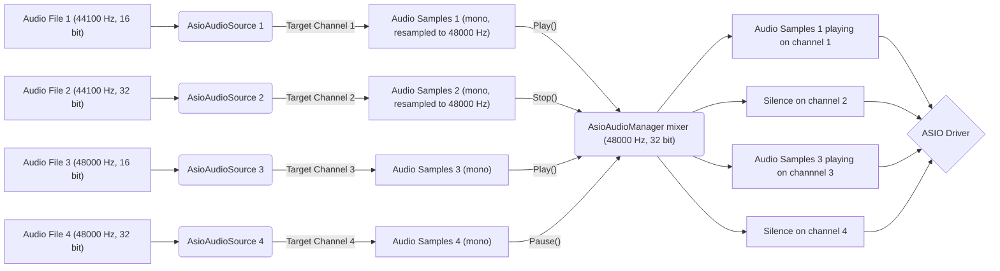

## Setup ASIO Audio Environment

If you begin in using the Asio Audio Unity plugin, you can start here by following this part of the documentation.

### Intended ASIO audio workflow

The intended working operation of this package is based on how Unity Audio Sources work. It tends to reproduce their behaviour with some additional parameters.

The component [AsioAudioSource](/Documentation~/Audio%20Components/AsioAudioSource.md) is the base component designed to replace the Unity Audio Source, with similar properties:
- Property `AudioClip` from Audio Source is replaced with `AudioFilePath`.
- Property `Volume` has the same name and behaviour.
- Property `PlayOnAwake` from Audio Source is replaced with `PlayOnEnable` (triggers `Play` from `OnEnable` instead from `Awake`).
- Property `Loop` has the same name and behaviour.

However, for all the [AsioAudioSource](/Documentation~/Audio%20Components/AsioAudioSource.md) components to work, the project needs **ASIO Audio Settings** (*Project Settings > ASIO Audio*), and they play through the [ASIO Audio Manager](/Documentation~/Audio%20Components/AsioAudioManager.md), which is created automatically.

There is multiple reasons that justify the need of this component:
- [AsioAudioSource](/Documentation~/Audio%20Components/AsioAudioSource.md) components can't send audio to the ASIO driver independently from each other, so a manager keeps one connection to the driver and continuously mixes all sources into it (each source on its own output channel).

- The ASIO driver runs at one sample rate and bit depth (bits per sample), set on the manager. Audio files can have any sample rate: each source mixes its file down to mono and resamples it on the fly to the manager's sample rate. No converted files are written to disk.

- ASIO drivers support a limited number of output channels, and each [AsioAudioSource](/Documentation~/Audio%20Components/AsioAudioSource.md) component has to be played on a specific channel, so a manager is needed to handle verification of [AsioAudioSource](/Documentation~/Audio%20Components/AsioAudioSource.md) `TargetOutputChannel` properties (validity and no duplicate).

Playing, pausing or stopping a source (or changing its volume, loop or output channel) is instant and doesn't interrupt the other sources: the driver keeps running. Only changing the manager's driver, sample rate or bit depth reconnects the driver (sources keep their state and position).

Here is a concrete example of the ASIO audio workflow:

### Setting up the ASIO driver (Project Settings)

The ASIO settings are **project settings**, used by every scene: there is no manager to add to the scene.

1. Open *Edit > Project Settings > ASIO Audio* (or *AsioAudioUnity > Project Settings…*).
2. The first time, click **Create ASIO Audio Settings**. The settings are saved in `Assets/Settings/ASIO Audio Settings.asset`, and included in builds automatically.
3. Choose the **Driver**, among the ASIO drivers installed on the machine. **Driver Control Panel** opens the driver's own settings (buffer size, clock...), also in Edit mode.
4. Set the **Sample Rate** to a rate supported by the driver (some drivers, like ReaRoute, only accept the sample rate of their host application), or the connection will fail with an error in the console. Keep the **Sample Format** at 32-bit float to get the driver's full resolution: the bit depth that actually reaches the audio interface is the driver's own format (for example 24-bit integer), shown as *Driver Format* once connected.

When the first [AsioAudioSource](/Documentation~/Audio%20Components/AsioAudioSource.md) is enabled in Play mode, the [ASIO Audio Manager](/Documentation~/Audio%20Components/AsioAudioManager.md) is created and connects to the driver: the console shows the driver, its number of outputs (the highest valid `TargetOutputChannel`) and its format. The connection status is also shown in Project Settings, in the ASIO Audio Mixer and in the in-game overlay (F9).

> **Connected, but nothing plays?** If the console warns that the driver *isn't asking for audio* (the sources show *Playing* but their time stays at 0), the driver isn't processing audio. With ReaRoute, REAPER must be running **with its audio device open**: check its audio device in *Options > Preferences > Audio > Device* (switch to REAPER and press Play once to make sure it runs), and make sure *Close audio device when stopped and application is inactive* (*Preferences > Audio*) is off, since Unity is the active application.

> **Scenes from before version 3.0** contain an `AsioAudioManager` component: open *Project Settings > ASIO Audio* and click *Migrate the Scene's ASIO Audio Manager* to move its settings to Project Settings and remove it.

### Setup ASIO Audio Sources

If you don't have any Unity Audio Source component in your scene, refer to [Setup ASIO Audio Sources In Scene](/Documentation~/SetupAsioAudioSourcesInScene.md).
If you have Unity Audio Source components in your scene, refer to [Setup ASIO Audio Sources From Scene With Audio Sources](/Documentation~/SetupFromSceneWithAudioSources.md).