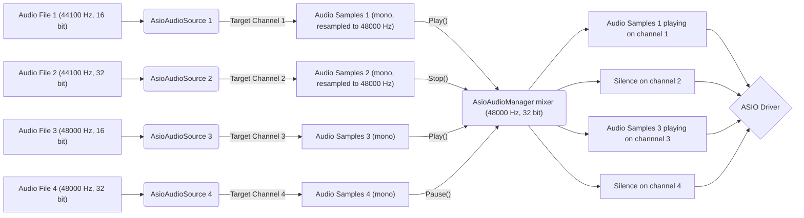

## Setup ASIO Audio Environment

If you begin in using the Asio Audio Unity plugin, you can start here by following this part of the documentation.

### Intended ASIO audio workflow

The intended working operation of this package is based on how Unity Audio Sources work. It tends to reproduce their behaviour with some additional parameters.

The component [AsioAudioSource](/Documentation~/Audio%20Components/AsioAudioSource.md) is the base component designed to replace the Unity Audio Source, with similar properties:
- Property `AudioClip` from Audio Source is replaced with `AudioFilePath`.
- Property `Volume` has the same name and behaviour.
- Property `PlayOnAwake` from Audio Source is replaced with `PlayOnEnable` (triggers `Play` from `OnEnable` instead from `Awake`).
- Property `Loop` has the same name and behaviour.

However, for all the [AsioAudioSource](/Documentation~/Audio%20Components/AsioAudioSource.md) components to work, we need an [AsioAudioManager](/Documentation~/Audio%20Components/AsioAudioManager.md) component on scene.

There is multiple reasons that justify the need of this component:
- [AsioAudioSource](/Documentation~/Audio%20Components/AsioAudioSource.md) components can't send audio to the ASIO driver independently from each other, so a manager keeps one connection to the driver and continuously mixes all sources into it (each source on its own output channel).

- The ASIO driver runs at one sample rate and bit depth (bits per sample), set on the manager. Audio files can have any sample rate: each source mixes its file down to mono and resamples it on the fly to the manager's sample rate. No converted files are written to disk.

- ASIO drivers support a limited number of output channels, and each [AsioAudioSource](/Documentation~/Audio%20Components/AsioAudioSource.md) component has to be played on a specific channel, so a manager is needed to handle verification of [AsioAudioSource](/Documentation~/Audio%20Components/AsioAudioSource.md) `TargetOutputChannel` properties (validity and no duplicate).

Playing, pausing or stopping a source (or changing its volume, loop or output channel) is instant and doesn't interrupt the other sources: the driver keeps running. Only changing the manager's driver, sample rate or bit depth reconnects the driver (sources keep their state and position).

Here is a concrete example of the ASIO audio workflow:

### Creating the ASIO Audio Manager

**Before adding any [AsioAudioSource](/Documentation~/Audio%20Components/AsioAudioSource.md) component , please verify that an [AsioAudioManager](/Documentation~/Audio%20Components/AsioAudioManager.md) component is already in scene.**

To add an [AsioAudioManager](/Documentation~/Audio%20Components/AsioAudioManager.md) component on scene, you can go multiple ways:

1. Use prefab: A prefab named `ASIO Audio Manager` is present on the `Packages` folder, at `Packages/Asio Audio Unity/Runtime/Prefabs/ASIO Audio Manager.prefab`, you can simply drag and drop this prefab on scene.
2. Setup GameObject: You can add a GameObject with an [AsioAudioManager](/Documentation~/Audio%20Components/AsioAudioManager.md) component on scene by going to *GameObject > AsioAudioUnity > ASIO Audio Manager*.

Once the [AsioAudioManager](/Documentation~/Audio%20Components/AsioAudioManager.md) is put in scene, you can set the `AsioDriverName` field with the ASIO driver name you want to connect to. If the name is correctly set, you shouldn't have any errors on the console. Moreover you can see the connection status in the Inspector in Play mode, and in the in-game overlay (shown when `DisplayInfoOnGameWindow` is ticked, toggled with F9 at runtime).

As channels are limited on ASIO drivers, you can see how many output channels are available on the ASIO driver you specified by looking at the `AsioDriverOutputChannelCount` property when starting the application.

Finally, make sure to set `TargetSampleRate` to a sample rate supported by the ASIO driver (some drivers, like ReaRoute, only accept the sample rate of their host application), or the connection will fail with an error in the console. `TargetBitsPerSample` sets the format the mix is handed over in (16-bit integer or 32-bit float). The bit depth that actually reaches the audio interface is the driver's own format (for example 24-bit integer), shown in `AsioDriverSampleFormat`, in the Inspector and in the overlay once connected. Keep 32-bit float to get the driver's full resolution.

### Setup ASIO Audio Sources

If you don't have any Unity Audio Source component in your scene, refer to [Setup ASIO Audio Sources In Scene](/Documentation~/SetupAsioAudioSourcesInScene.md).
If you have Unity Audio Source components in your scene, refer to [Setup ASIO Audio Sources From Scene With Audio Sources](/Documentation~/SetupFromSceneWithAudioSources.md).