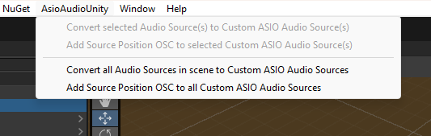

## Setup ASIO Audio Sources From Scene With Audio Sources

If you have an existing scene with Unity Audio Source components, you will need to convert these Audio Sources to ASIO Audio Sources, represented by the [AsioAudioSource](/Documentation~/Audio%20Components/AsioAudioSource.md) component.

### Convert Unity Audio Sources

To do this, go to *AsioAudioUnity > Convert all Audio Sources in scene to ASIO Audio Sources*. This should convert all (active and inactive) Audio Sources from scene to [AsioAudioSource](/Documentation~/Audio%20Components/AsioAudioSource.md) components, and automatically set the Output Channels.

**To setup OSC for your ASIO Audio Sources, refer to [Setup OSC Environment](/Documentation~/SetupOscEnvironment.md).**