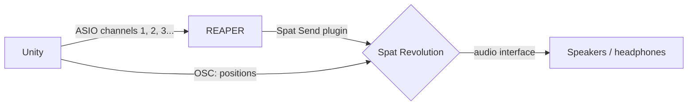
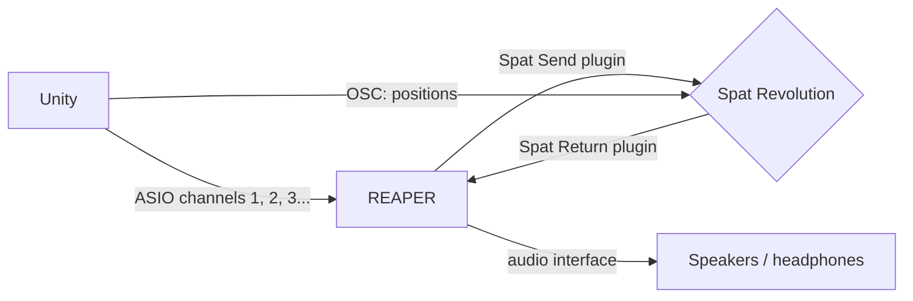

# 1. Installation

[Documentation home](/Documentation~/README.md) · Next: [2. Set up REAPER](/Documentation~/Tutorials/2-SetupReaper.md)

## Requirements

- **Windows**: ASIO drivers only exist on Windows. The package works in the Editor and in Windows builds.
- **Unity 6** (tested with Unity 6.3 LTS).
- For the full workflow of these tutorials (spatialising Unity's sounds with Spat Revolution):
  - [REAPER](https://www.reaper.fm/download.php), installed **with the ReaRoute ASIO driver** (see the next tutorial),
  - [Spat Revolution](https://www.flux.audio/project/spat-revolution/), installed from Flux Center (a license and a Flux account are needed).

Any other ASIO driver works too (an audio interface's driver, for example): REAPER and Spat Revolution are only needed for spatialisation.

## Install the package

1. In Unity, open *Window > Package Manager*.
2. Click **+** (top left) > **Add package from git URL…**
3. Paste `https://github.com/liris-xr/AsioAudioUnity.git` and click **Add**.

The package appears under *Packages > Asio Audio Unity*. To install a given version, add its tag at the end of the URL, e.g. `https://github.com/liris-xr/AsioAudioUnity.git#v3.1.0`.

## Import the demo scene

1. In the Package Manager, select **Asio Audio Unity**, open the **Samples** tab, and click **Import** next to *Demo Scene*.
2. The scene is copied to `Assets/Samples/Asio Audio Unity/[version]/Demo Scene/AsioAudioScene.unity`, with its four sounds.

The demo has four ASIO Audio Sources (on output channels 1 to 4), a Spat Controller that sends their positions to Spat Revolution, and a REAPER Controller. It is used in [4. First play in Unity](/Documentation~/Tutorials/4-FirstPlay.md).

## How it works

Unity's own audio can't send each sound to a separate output. This package replaces Unity's Audio Sources with **ASIO Audio Sources**: each one plays its file on **one output channel** of an ASIO driver. With the ReaRoute driver, each channel arrives on a REAPER track, which sends it to Spat Revolution through the **Spat Revolution Send** plugin. Meanwhile, the **Spat Controller** sends the position of each source to Spat Revolution over OSC, so the sound follows the object.

Spat Revolution calculates the spatialisation. Its result can then reach the speakers in two ways.

### A. Spat Revolution plays on the audio interface

Spat Revolution outputs the spatialised sound on the audio interface itself. REAPER only forwards Unity's channels: it has no audio output of its own (*Dummy Audio* device).

### B. REAPER plays on the audio interface

Spat Revolution sends the spatialised sound back to REAPER, through the **Spat Revolution Return** plugin, and REAPER outputs it on the audio interface (REAPER's audio device). Everything that reaches the speakers goes through REAPER, so it can be mixed, processed or recorded there, together with other tracks.

The Unity side is the same in both workflows. The next two tutorials show the settings that differ in REAPER and Spat Revolution.
