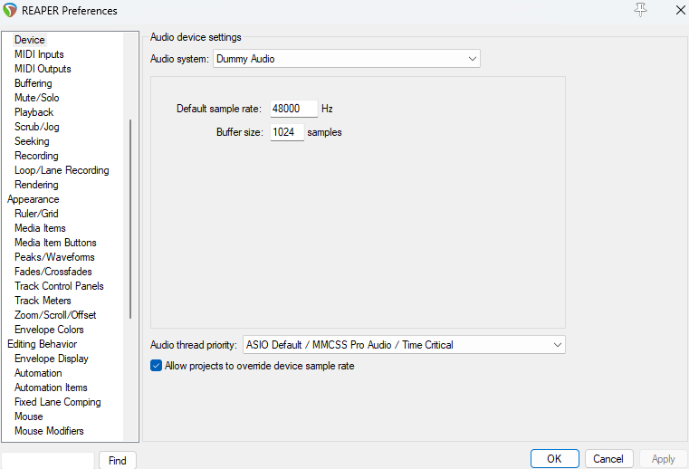
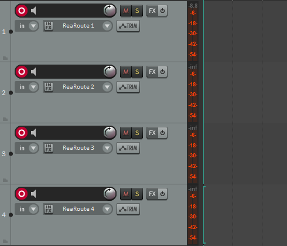
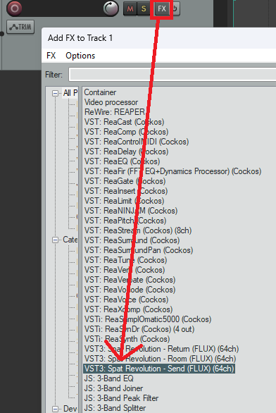
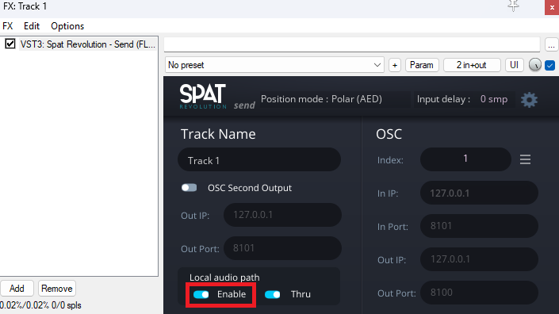
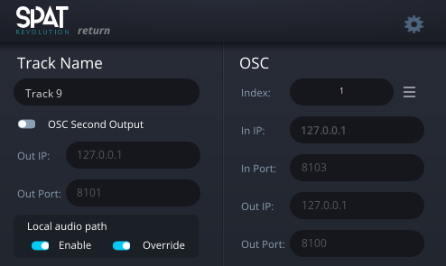

# 2. Set up REAPER

[Documentation home](/Documentation~/README.md) · Previous: [1. Installation](/Documentation~/Tutorials/1-Installation.md) · Next: [3. Set up Spat Revolution](/Documentation~/Tutorials/3-SetupSpatRevolution.md)

REAPER receives Unity's channels through the **ReaRoute ASIO** driver, one track per channel, and forwards them to Spat Revolution. This tutorial sets up 4 tracks, for the 4 sources of the demo scene.

Some steps depend on which application plays on the audio interface (see [How it works](/Documentation~/Tutorials/1-Installation.md#how-it-works)):

- **Workflow A**: Spat Revolution plays on the audio interface. REAPER has no audio output.
- **Workflow B**: Spat Revolution sends its result back to REAPER, and REAPER plays on the audio interface.

## Install REAPER with ReaRoute

Download REAPER [here](https://www.reaper.fm/download.php). In the installer, **tick ReaRoute ASIO driver**: it isn't selected by default, and Unity can't send audio to REAPER without it.

## Audio device

1. *Options > Preferences > Audio > Device*, **Audio System**:
   - **Workflow A**: **Dummy Audio**. REAPER doesn't output sound itself: Spat Revolution does.
   - **Workflow B**: **ASIO**, with your audio interface's driver. REAPER outputs the spatialised sound on it. (Unity still sends to REAPER through ReaRoute: the two drivers work side by side.)
2. Set the **sample rate** and the **block size**, among those supported by your audio interface. Use the same sample rate in Spat Revolution (next tutorial) and in Unity (*Project Settings > ASIO Audio*). In workflow A, use the same block size in Spat Revolution too.

   

3. *Options > Preferences > Audio*: turn off **Close audio device when stopped and application is inactive**. While you work in Unity, REAPER is inactive: if it closes its audio device, ReaRoute stops asking Unity for audio, and nothing is heard.

## One track per Unity channel

1. Create 4 tracks (*Ctrl+T*), and arm them for recording ().
2. On each track, click the record input () and choose **ReaRoute 1** to **ReaRoute 4**. If there are no ReaRoute inputs, REAPER was installed without the ReaRoute driver.

REAPER can now receive Unity's channels: ASIO output channel 3 in Unity arrives on the track whose input is ReaRoute 3.

## Send the tracks to Spat Revolution

The tracks reach Spat Revolution through the **Spat Revolution Send** plugin.

1. In Flux Center, install the Spat Revolution plugins (**Send**, and **Return** for workflow B). They are VST3 plugins.
2. In REAPER, *Options > Preferences > Plug-ins > VST*: check that `%COMMONPROGRAMFILES%\VST3` is in the plug-in paths, then click *Re-scan… > Clear cache and re-scan VST paths for all plugins*.
3. On each of the 4 tracks, click **FX** (not *IN FX*) and add `VST3: Spat Revolution - Send (FLUX) (64ch)`:

   

4. In the plugin's window, enable **Local Audio Path**:

   

5. In workflow B, the 4 tracks only feed Spat Revolution: untick their **Master send** (*Route* button), so their dry sound isn't played on the speakers along with the spatialised one.

## Workflow B: get the result back from Spat Revolution

In workflow B, the spatialised sound comes back into REAPER through the **Spat Revolution Return** plugin:

1. Create a track for the result, and set its number of channels (*Route* button > *Track channels*) to the number of channels of your output: 2 for headphones (binaural), or your number of speakers.
2. Click **FX** and add `VST3: Spat Revolution - Return (FLUX)`, with **Local Audio Path** enabled. It receives the output of Spat Revolution that you'll set up in the next tutorial.

   

3. Route this track to your audio interface's outputs: through the master, or with *Route* > *Audio hardware output*.

> To control REAPER from Unity (play REAPER when Unity plays, play regions…), REAPER also needs an OSC control surface: see [7. Control REAPER from Unity](/Documentation~/Tutorials/7-ControlReaper.md).
