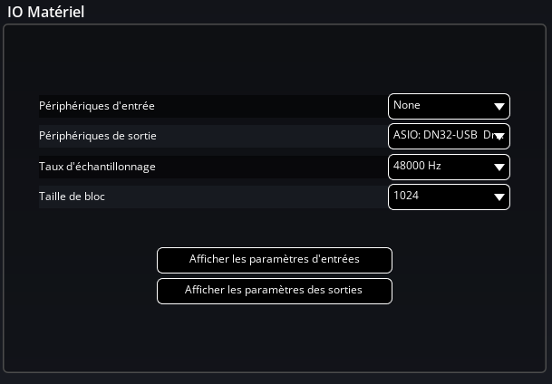
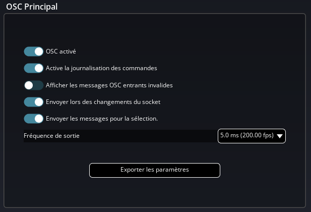
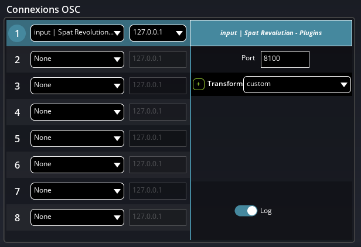
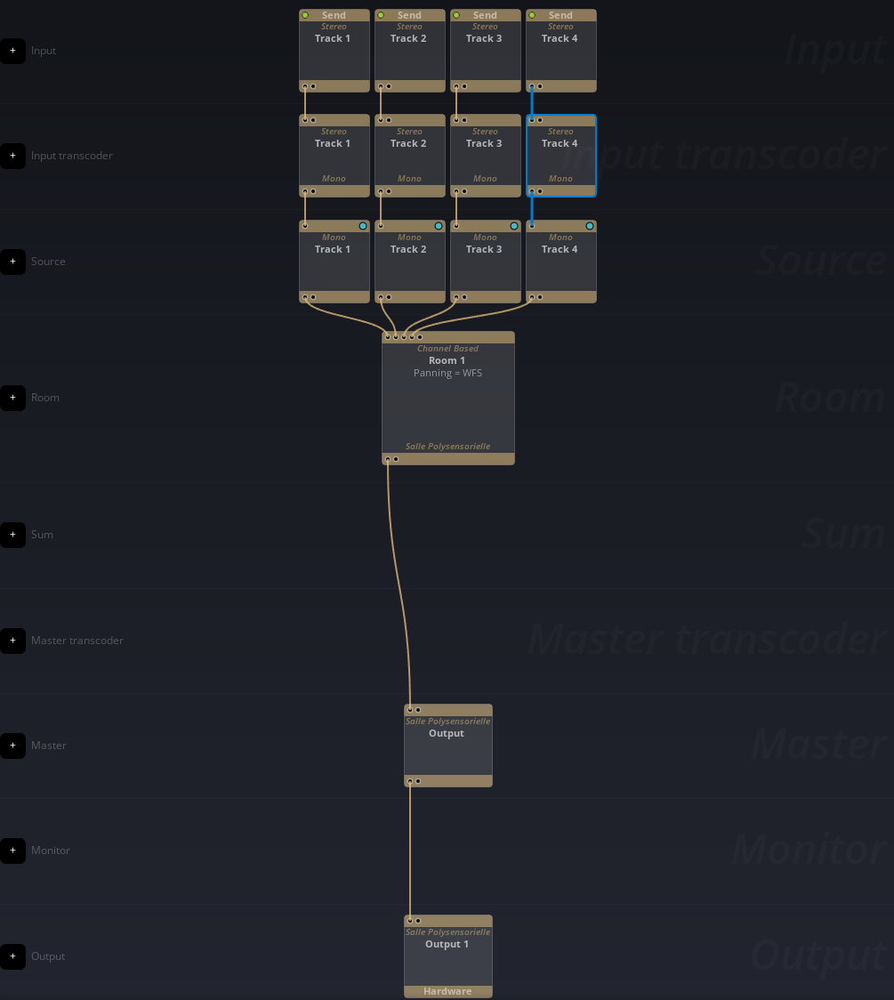

# 3. Set up Spat Revolution

[Documentation home](/Documentation~/README.md) · Previous: [2. Set up REAPER](/Documentation~/Tutorials/2-SetupReaper.md) · Next: [4. First play in Unity](/Documentation~/Tutorials/4-FirstPlay.md)

Spat Revolution receives the 4 tracks from REAPER and the positions from Unity, and calculates the spatialisation for your speakers or headphones. Install it from [Flux Center](https://www.flux.audio/download/), then open the **Preferences** tab.

Its result goes either to the audio interface (**workflow A**) or back to REAPER (**workflow B**): see [How it works](/Documentation~/Tutorials/1-Installation.md#how-it-works).

## Audio output

- **Workflow A**: in *IO Hardware*, choose your output device (an ASIO device), and set the **sample rate** and **block size** to the same values as REAPER's Dummy Audio device (previous tutorial), to avoid audio artifacts.

  

- **Workflow B**: Spat Revolution doesn't play on the audio interface: its output goes back to REAPER's Return plugin, through the Local Audio Path (see step 4 of the audio chain below). Use the same sample rate as REAPER.

## Positions from Unity (OSC)

*OSC Main*: enable OSC (first button), then add an OSC connection **input | Spat Revolution - Plugins** with the IP address **127.0.0.1** (Unity on the same computer) and the port **8100** (the Spat Controller's default).

 

## The audio chain

In the **Setup** tab, the *Input* line shows the 4 inputs coming from REAPER's tracks (if not, check the *Local Audio Path* of the Send plugins in REAPER). Then:

1. On the *Source Transcoder* line, add 4 transcoders, connect them to the 4 inputs, and set their *Output Configuration* to **Mono**.
2. On the *Source* line, add 4 sources (Mono), and connect them to the 4 transcoders.
3. On the *Room* line, add a room with the output configuration you want (your speaker layout, or binaural), and connect the 4 sources to it.
4. On the *Output* line, add an output and connect it to the room (a *Master* is added in between). Its destination is:
   - **workflow A**: the hardware outputs of your audio interface,
   - **workflow B**: the **Spat Revolution Return** plugin of REAPER's result track (Local Audio Path), with as many channels as that track. See Flux's documentation for the details of the Local Audio Path return.

The **Room** tab shows the room and its sources: they move when Unity sends positions.

Source **1** in Spat Revolution is the sound of Unity's output channel 1, and so on: Unity, REAPER and Spat use the same numbers.
