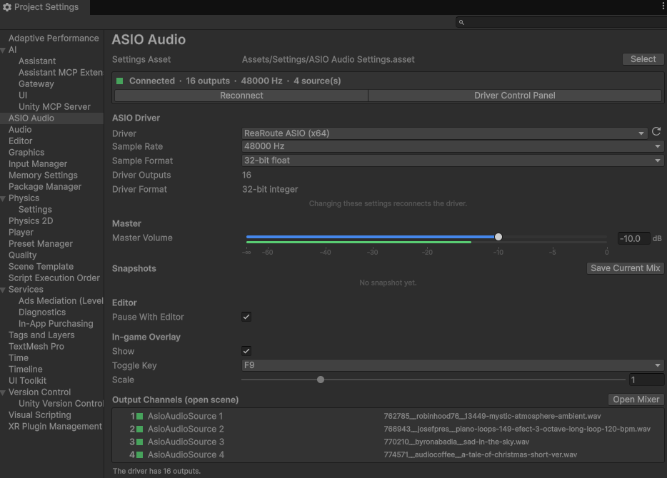
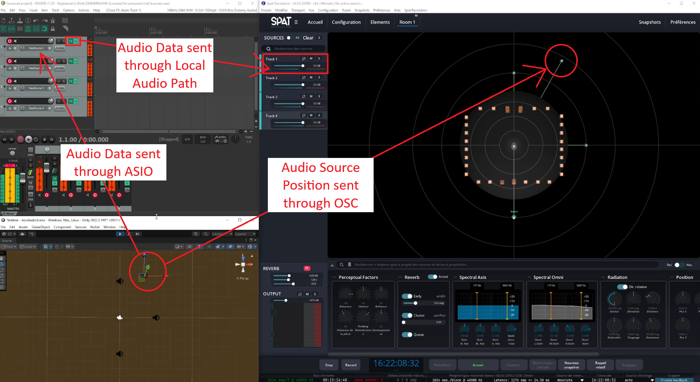
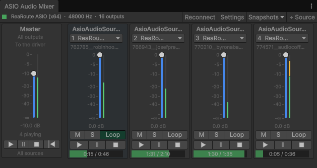

# 4. First play in Unity

[Documentation home](/Documentation~/README.md) · Previous: [3. Set up Spat Revolution](/Documentation~/Tutorials/3-SetupSpatRevolution.md) · Next: [5. ASIO sources in your scene](/Documentation~/Tutorials/5-AddSources.md)

With REAPER and Spat Revolution running, this tutorial plays the demo scene and checks each link of the chain.

## Choose the ASIO driver

The ASIO settings are **project settings**: they are used by every scene, and there is nothing to add to the scene.

1. Open *Edit > Project Settings > ASIO Audio* (or *AsioAudioUnity > Project Settings…*).
2. The first time, click **Create ASIO Audio Settings**: the settings are saved in `Assets/Settings/ASIO Audio Settings.asset`, and included in builds.
3. **Driver**: choose **ReaRoute ASIO (x64)**.
4. **Sample Rate**: the same as REAPER's. ReaRoute only accepts the sample rate of REAPER: with another one, the connection fails with an error in the Console.
5. Optionally, click **Driver Control Panel**: this loads the driver, and shows its number of outputs (*Driver Outputs*: 16 for ReaRoute) and its format (*Driver Format*).

Keep the *Sample Format* at 32-bit float. See [ASIO Audio Settings](/Documentation~/Reference/AsioAudioSettings.md) for every setting.

 ASIO Audio, connected to ReaRoute" width="700"/>

## Play the demo scene

1. Open the demo scene (`Assets/Samples/Asio Audio Unity/[version]/Demo Scene/AsioAudioScene.unity`).
2. Press **Play**. The Console shows `ASIO Audio Manager: connected to "ReaRoute ASIO (x64)" (16 outputs, 48000 Hz…)`: the manager that plays the sources was created and connected to the driver.
3. The 4 sources start (they have *Play On Enable*), each on its output channel: in REAPER, the meters of the 4 tracks move, and you hear the spatialised sounds (played by Spat Revolution in workflow A, or by REAPER's result track in workflow B).
4. Move a source in the Scene view: it moves in Spat Revolution's *Room* tab. The Main Camera is sent as the room's position.

Nothing heard, or an error? See [Troubleshooting](/Documentation~/Tutorials/Troubleshooting.md).

## Look around

- **ASIO Audio Mixer** (*AsioAudioUnity > ASIO Audio Mixer*): one strip per source, with its channel, volume fader, level meter, mute / solo and transport, and a *Master* strip that plays, pauses or stops all sources together. See [ASIO Audio Mixer](/Documentation~/Reference/AsioAudioMixer.md).

  

- **In-game overlay** (press **F9** in the Game view): the same controls, also in builds.
- **An ASIO Audio Source's Inspector**: its file and waveform, fades, loop, volume and output channel. See [AsioAudioSource](/Documentation~/Reference/AsioAudioSource.md).
- **Pause** the editor: the sources pause too, and REAPER follows (the demo scene has a REAPER Controller; see [7. Control REAPER from Unity](/Documentation~/Tutorials/7-ControlReaper.md)).
