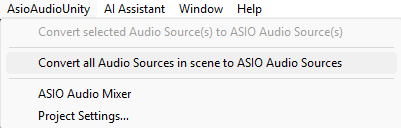
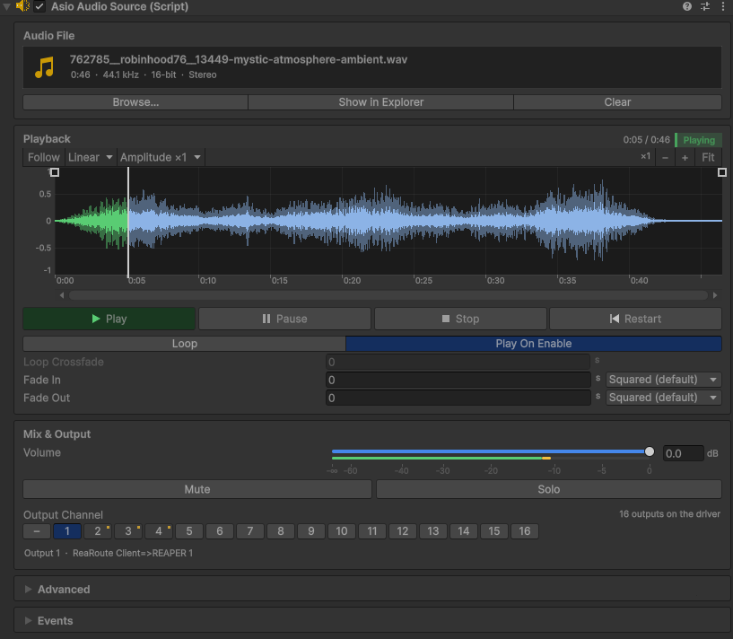

# 5. ASIO sources in your scene

[Documentation home](/Documentation~/README.md) · Previous: [4. First play in Unity](/Documentation~/Tutorials/4-FirstPlay.md) · Next: [6. Send positions to Spat](/Documentation~/Tutorials/6-SendPositionsToSpat.md)

An **ASIO Audio Source** works like a Unity Audio Source, but plays on one channel of the ASIO driver.

| **Unity Audio Source** | **ASIO Audio Source** |
|-|-|
| `AudioClip` | `AudioFilePath`: the path of the audio file (it doesn't need to be imported as an AudioClip) |
| `Volume` | `Volume` (or `VolumeDecibels`) |
| `PlayOnAwake` | `PlayOnEnable` |
| `Loop` | `Loop`, with an optional crossfade at the loop point |
| (Unity's audio output) | `TargetOutputChannel`: the ASIO output channel, unique per source |

## Create ASIO Audio Sources

- **New source**: *GameObject > AsioAudioUnity > ASIO Audio Source* (on the next free channel), or drag the `ASIO Audio Source` prefab (`Packages/Asio Audio Unity/Runtime/Prefabs`).
- **From existing Audio Sources**: *AsioAudioUnity > Convert all Audio Sources in scene to ASIO Audio Sources* (active and inactive ones), or select some and use *AsioAudioUnity > Convert selected Audio Source(s) to ASIO Audio Source(s)*. Their clip, volume, loop and play-on-awake are kept, and output channels are assigned.

  

## Set each source



1. **Audio file**: drag a file onto the *Audio File* card of the Inspector, or click *Browse…*. WAV, AIFF, MP3 and FLAC work (not OGG). Use files inside the project's `Assets` folder: they are copied with builds automatically.
2. **Output channel**: pick it in the channel grid of the *Mix & Output* card. Each source needs its own channel, between 1 and the driver's number of outputs: channels used by other sources are marked, and conflicts show a warning (*Project Settings > ASIO Audio > Output Channels* can fix them all).
3. **Playback**: *Play On Enable*, *Loop* (and *Loop Crossfade* for files that don't loop cleanly), *Fade In* / *Fade Out*.
4. **Preview** (in Edit mode): plays the source through the driver without entering Play mode.

All the options are described in [AsioAudioSource](/Documentation~/Reference/AsioAudioSource.md).

## Play sources from scripts

```cs
using UnityEngine;
using AsioAudioUnity;

public class Cue : MonoBehaviour
{
    [SerializeField] private AsioAudioSource _ambience;

    public void StartAmbience()
    {
        _ambience.VolumeDecibels = -6f;
        _ambience.Play();
    }

    public void StartAllTogether()
    {
        AsioAudioManager.Instance.PlayAll(); // every source starts on the same sample
    }
}
```

Calling `Play` on several sources one after the other can start them a few milliseconds apart: to keep stems in sync, use the manager's `PlayAll`, `PauseAll`, `StopAll` and `RestartAll` (see [AsioAudioManager](/Documentation~/Reference/AsioAudioManager.md)).

## Mix

Open *AsioAudioUnity > ASIO Audio Mixer* to set the volumes side by side, and save mixes as **snapshots** to recall them later (from the mixer, from code, or over OSC). See [ASIO Audio Mixer](/Documentation~/Reference/AsioAudioMixer.md).
