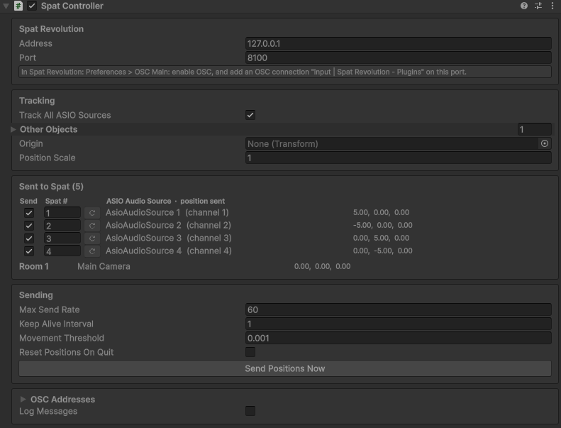

# 6. Send positions to Spat Revolution

[Documentation home](/Documentation~/README.md) · Previous: [5. ASIO sources in your scene](/Documentation~/Tutorials/5-AddSources.md) · Next: [7. Control REAPER from Unity](/Documentation~/Tutorials/7-ControlReaper.md)

The **Spat Controller** sends the position of every ASIO Audio Source (and of rooms) to Spat Revolution, so each sound follows its object. One component does it for the whole scene. Spat Revolution must listen to OSC on port 8100 (see [3. Set up Spat Revolution](/Documentation~/Tutorials/3-SetupSpatRevolution.md#positions-from-unity-osc)).

## Add a Spat Controller

1. *GameObject > AsioAudioUnity > Spat Controller* (or drag the `Spat Controller` prefab, in `Packages/Asio Audio Unity/Modules/SpatOsc/Runtime/Prefabs`).
2. Check the **Address** (127.0.0.1 if Spat Revolution runs on this computer) and the **Port** (8100).
3. Keep **Track All ASIO Sources** ticked: every ASIO Audio Source is sent as the Spat source numbered like its **output channel**, the REAPER track and Spat input its sound arrives on.
4. Click **Send Positions Now**: the sources move in Spat Revolution's *Room* tab (this also works in Edit mode).

In Play mode, positions are sent when objects move, and re-sent every second in case Spat Revolution restarts.

## Rooms and other objects

To send the position of a room (the listener, for example), add it in **Other Objects**: drag its Transform, choose **Room**, and set its number in Spat Revolution. The demo scene sends its Main Camera as room 1. Objects that aren't ASIO Audio Sources can be sent as sources the same way.

## Coordinates

Unity's Y axis points up; Spat Revolution's Z axis does: the Spat Controller converts them. Set an **Origin** (e.g. the centre of your room) to send positions relative to it, and a **Position Scale** if your scene's units aren't metres.

## Orientation

For directivity, tick **Send Orientation** (in the *Sending* card): the yaw and pitch of each source are sent too, relative to the Origin. If the sources turn the wrong way in Spat Revolution, tick **Invert Yaw**. See [Orientation](/Documentation~/Reference/SpatController.md#orientation).

## Different numbers in Spat Revolution

If a source must be another Spat source than its output channel, change its **Spat #** in the *Sent to Spat* table, or untick **Send** to stop sending it. The reset button goes back to the output channel, and two sources with the same number show a warning.

All the settings are described in [SpatController](/Documentation~/Reference/SpatController.md).

> **Scenes from before version 3.0** send positions with a *Source Position OSC* or *Room Position OSC* component on each object. Their Inspector has a **Replace with Spat Controller** button: see [Legacy position components](/Documentation~/Reference/LegacyPositionComponents.md).
