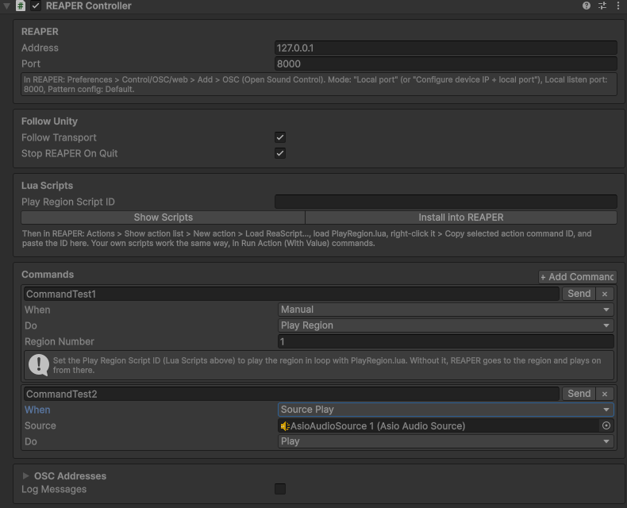

# 7. Control REAPER from Unity

[Documentation home](/Documentation~/README.md) · Previous: [6. Send positions to Spat](/Documentation~/Tutorials/6-SendPositionsToSpat.md) · Next: [8. Control Unity over OSC](/Documentation~/Tutorials/8-ControlUnityOverOsc.md)

The **REAPER Controller** sends OSC commands to REAPER: REAPER plays when Unity plays, and Unity can play regions, go to markers, or run actions and Lua scripts, when something happens in the scene.

## Let REAPER receive OSC

1. In REAPER, *Options > Preferences > Control/OSC/web > Add*, and choose **OSC (Open Sound Control)**.
2. Mode: **Local port**. **Local listen port: 8000**. Pattern config: **Default**.
3. Click **OK**.

## Follow Unity's transport

1. In Unity, *GameObject > AsioAudioUnity > REAPER Controller*.
2. Check the **Address** (127.0.0.1 if REAPER runs on this computer) and the **Port** (8000).
3. Keep **Follow Transport** ticked.

Now, when the scene starts with sources playing, REAPER plays from the start of its project. *Play All*, *Pause All*, *Stop All* and *Restart All* (from the ASIO Audio Mixer's *Master* strip, the overlay, code or OSC) are mirrored in REAPER, and so is the editor's Pause button. When Play mode ends, REAPER stops.

## Follow REAPER (two-way)

To start and stop the show from REAPER too, Unity can follow REAPER's transport:

1. In REAPER's OSC control surface, set the Mode to **Configure device IP + local port**, the **Device IP** to 127.0.0.1 (Unity on the same computer), and the **Device port** to **9000**.
2. In the REAPER Controller, tick **Follow REAPER** (Listen Port: 9000).

Playing, pausing or stopping REAPER now plays, pauses or stops Unity's sources. See [Two-way sync](/Documentation~/Reference/ReaperController.md#two-way-sync).

## Send commands on Unity events

In the **Commands** list, add a command, then choose:

- **When**: on scene start, on *Play All* / *Pause All* / *Stop All* / *Restart All*, when a given source plays, pauses or stops, or *Manual* (from a script or a UnityEvent),
- **Do**: play, stop, go to a time, a marker or a region, play a region in loop, run an action or a Lua script, or send any OSC message.

Click **Send** next to a command to test it. From a script or a UnityEvent, call `Trigger("command name")`.

## Play regions in loop

*Play Region* commands use **PlayRegion.lua**, which comes with the package:

1. In the REAPER Controller's Inspector, click **Install into REAPER** (the script is copied to REAPER's scripts folder).
2. In REAPER, *Actions > Show action list > New action > Load ReaScript…*, and select `AsioAudioUnity/PlayRegion.lua`.
3. Right-click it in the list > **Copy selected action command ID**, and paste it in the controller's **Play Region Script ID**.

A *Play Region* command with region number 2 then plays region 2 in loop.

Commands can also be placed on a Timeline, as markers of a **REAPER Command track**: see [Timeline tracks](/Documentation~/Reference/Timeline.md#reaper-command-markers).

All the commands and settings are described in [ReaperController](/Documentation~/Reference/ReaperController.md).
