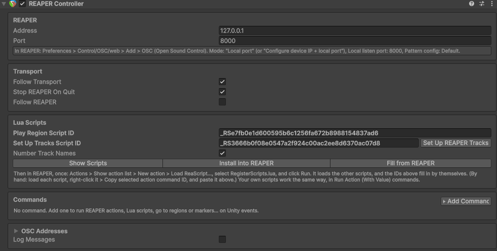

# 7. Control REAPER from Unity

[Documentation home](/Documentation~/README.md) · Previous: [6. Send positions to Spat](/Documentation~/Tutorials/6-SendPositionsToSpat.md) · Next: [8. Control Unity over OSC](/Documentation~/Tutorials/8-ControlUnityOverOsc.md)

The **REAPER Controller** sends OSC commands to REAPER: REAPER plays when Unity plays, and Unity can play regions, go to markers, or run actions and Lua scripts, when something happens in the scene.

## Let REAPER receive OSC

1. In REAPER, *Options > Preferences > Control/OSC/web > Add*, and choose **OSC (Open Sound Control)**.
2. Mode: **Local port**. **Local listen port: 8000**. Pattern config: **Default**.
3. Click **OK**.

## Follow Unity's transport

1. In Unity, *GameObject > AsioAudioUnity > REAPER Controller*.
2. Check the **Address** (127.0.0.1 if REAPER runs on this computer) and the **Port** (8000).
3. Keep **Follow Transport** ticked.

Now, when the scene starts with sources playing, REAPER plays from the start of its project. *Play All*, *Pause All*, *Stop All* and *Restart All* (from the ASIO Audio Mixer's *Master* strip, the overlay, code or OSC) are mirrored in REAPER, and so is the editor's Pause button. When Play mode ends, REAPER stops.

## Follow REAPER (two-way)

To start and stop the show from REAPER too, Unity can follow REAPER's transport:

1. In REAPER's OSC control surface, set the Mode to **Configure device IP + local port**, the **Device IP** to 127.0.0.1 (Unity on the same computer), and the **Device port** to **9000**.
2. In the REAPER Controller, tick **Follow REAPER** (Listen Port: 9000).

Playing, pausing or stopping REAPER now plays, pauses or stops Unity's sources. See [Two-way sync](/Documentation~/Reference/ReaperController.md#two-way-sync).

## Send commands on Unity events

In the **Commands** list, add a command, then choose:

- **When**: on scene start, on *Play All* / *Pause All* / *Stop All* / *Restart All*, when a given source plays, pauses or stops, or *Manual* (from a script or a UnityEvent),
- **Do**: play, stop, go to a time, a marker or a region, play a region in loop, run an action or a Lua script, or send any OSC message.

Click **Send** next to a command to test it. From a script or a UnityEvent, call `Trigger("command name")`.

## Install the Lua scripts

The package comes with Lua scripts for REAPER: **PlayRegion.lua** (plays a region in loop) and **SetupTracks.lua** (creates REAPER's tracks). Install them once:

1. In the REAPER Controller's Inspector, click **Install into REAPER** (the scripts are copied to REAPER's scripts folder).
2. In REAPER, *Actions > Show action list > New action > Load ReaScript…*, select `AsioAudioUnity/RegisterScripts.lua`, and click **Run**. It loads the other scripts into the action list and gives their command IDs to Unity.
3. Select the REAPER Controller: **Play Region Script ID** and **Set Up Tracks Script ID** fill in by themselves.

If REAPER is reinstalled, or the project moves to another computer, run `RegisterScripts.lua` again: the Inspector and the Setup Check then offer **Fill from REAPER**. (By hand: load each script with *Load ReaScript…*, right-click it > **Copy selected action command ID**, and paste it in the controller.)

## Play regions in loop

*Play Region* commands use **PlayRegion.lua** (see [Install the Lua scripts](#install-the-lua-scripts)). A *Play Region* command with region number 2 plays region 2 in loop.

## Create REAPER's tracks from Unity

**SetupTracks.lua**, installed with the other scripts, creates or updates one REAPER track per ASIO Audio Source:

1. Check that **Set Up Tracks Script ID** is filled in (see [Install the Lua scripts](#install-the-lua-scripts)).
2. Click **Set Up REAPER Tracks** (also in Edit mode). Each source gets a track named like it, after its Spat source number (e.g. `3 · Violin`, to match tracks and Spat sources at a glance; untick **Number Track Names** for the plain name), on its ReaRoute input (a stereo source gets a stereo track), armed with input monitoring and set not to record files, without a master send (the tracks only feed Spat Revolution, so their dry sound isn't heard along with the spatialised one), with the Spat Revolution Send plugin and its *Local Audio Path* enabled.
3. Read REAPER's console (it opens with the script's summary). If it says the plugin's *Audio Enable* parameter wasn't found, enable it in one Send plugin, save that plugin as an FX chain named **AsioAudioUnity Spat Send** (*FX > Save chain…*), and click **Set Up REAPER Tracks** again: new tracks then get the plugin from that chain, already set up. Enable it by hand in the plugins that were added before.

4. Click **Test Channels** (in the Setup Check or the ASIO Audio Mixer): each source beeps in turn, and the window says which one. Its REAPER track, and its Spat Revolution source, should show a level at the same time.

Click **Set Up REAPER Tracks** again after adding or changing sources: it updates the tracks it created, without duplicating or deleting any.

Commands can also be placed on a Timeline, as markers of a **REAPER Command track**: see [Timeline tracks](/Documentation~/Reference/Timeline.md#reaper-command-markers).

All the commands and settings are described in [ReaperController](/Documentation~/Reference/ReaperController.md).
