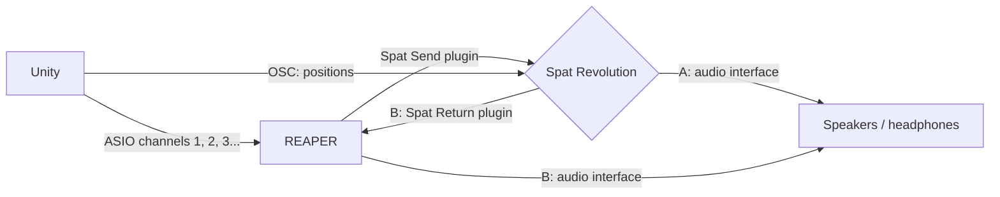

# Asio Audio for Unity

Play Unity's sounds through an **ASIO driver**, each sound on its own output channel, and send their **positions over OSC**. With [REAPER](https://www.reaper.fm/) (through its ReaRoute ASIO driver) and [Spat Revolution](https://www.flux.audio/project/spat-revolution/), this spatialises a Unity scene on any speaker layout.

Unity sends each sound to REAPER on its own channel, and its position to Spat Revolution. Spat Revolution calculates the spatialisation, then either plays the result on the audio interface itself (**A**), or sends it back to REAPER, which plays it (**B**):

See [How it works](/Documentation~/Tutorials/1-Installation.md#how-it-works) for the two workflows.

## Features

- **ASIO Audio Source**: replaces Unity's Audio Source, and plays a WAV, AIFF, MP3 or FLAC file on one ASIO output channel (or a multichannel file on consecutive channels), with fades, a smooth (crossfaded) loop, mute / solo, and a waveform in the Inspector.
- **Sample-accurate sync**: Play All, Pause All, Stop All and Restart All start every source on the same sample.
- **Mixing**: the ASIO Audio Mixer window, an in-game overlay (also in builds), dB faders and meters, and mix snapshots.
- **Timeline**: ASIO Audio tracks to lay out cues, and REAPER Command markers.
- **Works without ASIO**: on a computer without the show's driver, the sources play through Unity's audio, so a project can be worked on anywhere.
- **Spat OSC plugin**: the Spat Controller sends the positions (and optionally orientations) of every source and room to Spat Revolution.
- **REAPER OSC plugin**: the REAPER Controller follows Unity's transport (and Unity can follow REAPER's), plays regions, and runs actions and Lua scripts on Unity events.
- **OSC remote**: control playback, volumes and snapshots from another application (TouchOSC, REAPER, Max...).

Windows only (ASIO). Tested with Unity 6.3 LTS.

## How to install

1. In Unity, open *Window > Package Manager*.
2. Click **+** > **Add package from git URL...**
3. Paste `https://github.com/liris-xr/AsioAudioUnity.git` and click **Add**.

A demo scene can be imported from the package's **Samples** tab in the Package Manager.

## Getting started

Follow the [tutorials](/Documentation~/README.md#tutorials), in order:

1. [Installation](/Documentation~/Tutorials/1-Installation.md)
2. [Set up REAPER](/Documentation~/Tutorials/2-SetupReaper.md)
3. [Set up Spat Revolution](/Documentation~/Tutorials/3-SetupSpatRevolution.md)
4. [First play in Unity](/Documentation~/Tutorials/4-FirstPlay.md)
5. [ASIO sources in your scene](/Documentation~/Tutorials/5-AddSources.md)
6. [Send positions to Spat Revolution](/Documentation~/Tutorials/6-SendPositionsToSpat.md)
7. [Control REAPER from Unity](/Documentation~/Tutorials/7-ControlReaper.md)
8. [Control Unity over OSC](/Documentation~/Tutorials/8-ControlUnityOverOsc.md)

## Documentation

The [documentation home](/Documentation~/README.md) has the tutorials, the [reference](/Documentation~/README.md#reference) of every component and setting, and [troubleshooting](/Documentation~/Tutorials/Troubleshooting.md). The changes of each version are in the [changelog](/CHANGELOG.md).

## Credits

- [NAudio](https://github.com/naudio/NAudio) by Mark Heath, an open-source .NET audio library: ASIO output and audio file decoding.
- [UnityOSC](https://t-o-f.info/UnityOSC/) by Thomas Fredericks: OSC messages.
